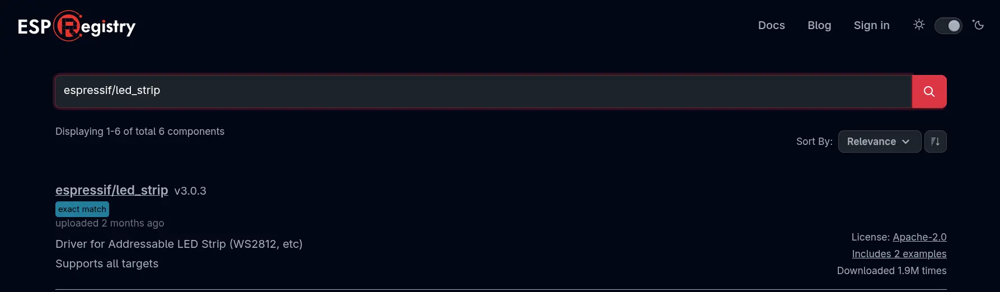

## Úkol 2: Základy: Hello World & LED

---

V tomto úkolu vytvoříme náš první projekt, ověříme, že ho dokážeme zbuildovat a nahrát do desky s ESP32-C5, a naučíme se používat komponenty z příkazové řádky (CLI).

> **Tento projekt si ponechte!** Budeme na něm dál stavět: Úkol 3 (Wi-Fi provisioning) používá přesně tuto složku projektu a Úkol 4 (OTA) na něj navazuje. Teprve Úkoly 5 (ESP-NOW) a 6 (LP-core) začínají s čistým projektem, protože jejich kód nemá s tím, co zde napíšeme, mnoho společného. Pokaždé vám připomeneme, jestli projekt použít znovu, nebo začít od nuly.

### 1. Vytvoření nového projektu

Místo průvodce v GUI použijeme CLI ESP-IDF. Otevřete ESP-IDF Terminal a přejděte do složky, kde chcete mít svůj projekt.

```bash
idf.py create-project my_first_project
cd my_first_project
```

Tím se vytvoří základní adresářová struktura se souborem `CMakeLists.txt` a složkou `main` obsahující `main.c`.

### 2. Nastavení targetu

Před buildem musíme ESP-IDF říct, pro jaký čip kompilujeme. Spusťte následující příkaz:

```bash
idf.py set-target esp32c5
```

Tím se vygeneruje soubor `sdkconfig` s výchozí konfigurací pro ESP32-C5.

### 3. Přidání komponenty

Chceme ovládat vestavěnou RGB LED (WS2812) na našem DevKitu. Tato LED je připojená ke GPIO 27.
Pro snadné ovládání přidáme komponentu `led_strip` z Espressif Component Registry.

V adresáři projektu spusťte následující příkaz:

```bash
idf.py add-dependency "espressif/led_strip^3.0.3"
```

Tím se vytvoří soubor `main/idf_component.yml`. Při buildu projektu ESP-IDF potřebnou komponentu automaticky stáhne.

> **Tip:** Výše uvedený příkaz dělá totéž, jako když komponentu najdete na webu a kliknete na „Install“. Libovolnou komponentu si můžete předem prohlédnout na [ESP Component Registry](https://components.espressif.com/) a zkontrolovat její README, příklady a závislosti.
>
> 
>
> 

### 4. Psaní kódu

Místo vložení celého kusu kódu a doufání, že bude dávat smysl, ho postavíme po částech. Otevřete `main/main.c` ve VS Code, jeho obsah budeme postupně nahrazovat.

#### 4.1 Kostra

Tady je tvar toho, co za chvíli napíšeme. Mějte tuto strukturu na paměti, zatímco ji budeme vyplňovat:

```c
#include <stdio.h>
#include "freertos/FreeRTOS.h"
#include "freertos/task.h"
#include "led_strip.h"
#include "esp_log.h"
#include "esp_err.h"

// (A) A helper that sets up the WS2812 LED and returns a handle to it

led_strip_handle_t configure_led(void)
{
    // ... configuration goes here ...
}

void app_main(void)
{
    // (B) Create the LED handle
    // (C) Set it to a color
    // (D) Keep the task alive so the board doesn't just reboot
}
```

#### 4.2 Část (A): Konfigurace LED

Ovladač `led_strip` potřebuje dvě konfigurační struktury: jedna popisuje, *co* je připojeno (který GPIO, kolik LED, jaké je pořadí barev), a druhá, *jak* ji ovládat (periferie RMT se používá ke generování přesného časování, které LED WS2812 potřebují).

```c
#define LED_STRIP_RMT_RES_HZ  (10 * 1000 * 1000)
static const char *TAG = "workshop";

led_strip_handle_t configure_led(void)
{
    led_strip_config_t strip_config = {
        .strip_gpio_num = 27,
        .max_leds = 1,
        .color_component_format = LED_STRIP_COLOR_COMPONENT_FMT_GRB,
        .led_model = LED_MODEL_WS2812,
        .flags.invert_out = false,
    };

    led_strip_rmt_config_t rmt_config = {
        .clk_src = RMT_CLK_SRC_DEFAULT,
        .resolution_hz = LED_STRIP_RMT_RES_HZ,
        .mem_block_symbols = 0,
        .flags.with_dma = false,
    };

    led_strip_handle_t led_strip;
    ESP_ERROR_CHECK(led_strip_new_rmt_device(&strip_config, &rmt_config, &led_strip));
    ESP_LOGI(TAG, "LED strip initialized successfully");
    return led_strip;
}
```

Vložte tento kód nad `app_main`. Na devkitu je přesně jedna LED (`.max_leds = 1`) a je připojená ke GPIO 27.

#### 4.3 Části (B)-(D): `app_main`

```c
void app_main(void)
{
    ESP_LOGI(TAG, "Hello ESP32-C5!");

    // (B) Create the LED handle
    led_strip_handle_t led_strip = configure_led();

    // (C) Set color to Red
    ESP_ERROR_CHECK(led_strip_set_pixel(led_strip, 0, 20, 0, 0));
    ESP_ERROR_CHECK(led_strip_refresh(led_strip));
    ESP_LOGI(TAG, "LED set to Red");

    // (D) app_main must not return, otherwise the system considers the app finished
    while (1) {
        vTaskDelay(1000 / portTICK_PERIOD_MS);
    }
}
```

`led_strip_set_pixel` pouze aktualizuje buffer v paměti; dokud nezavoláte `led_strip_refresh`, nic se do LED neodešle. Tři čísla (`20, 0, 0`) jsou jas červené, zelené a modré (každé 0-255); držíme je nízko, aby LED neoslepovala.

#### 4.4 Kompletní kód

Spojením všeho dohromady získáte celý soubor `main/main.c`. Pokud ho nechcete opisovat, hotový projekt najdete také v [`examples/C5/assignment-02-led-components`](../../../examples/C5/assignment-02-led-components/). Můžete svůj soubor porovnat s ním (diff) nebo ho rovnou zkopírovat.

```c
#include <stdio.h>
#include "freertos/FreeRTOS.h"
#include "freertos/task.h"
#include "led_strip.h"
#include "esp_log.h"
#include "esp_err.h"

#define LED_STRIP_RMT_RES_HZ  (10 * 1000 * 1000)
static const char *TAG = "workshop";

led_strip_handle_t configure_led(void)
{
    led_strip_config_t strip_config = {
        .strip_gpio_num = 27,
        .max_leds = 1,
        .color_component_format = LED_STRIP_COLOR_COMPONENT_FMT_GRB,
        .led_model = LED_MODEL_WS2812,
        .flags.invert_out = false,
    };

    led_strip_rmt_config_t rmt_config = {
        .clk_src = RMT_CLK_SRC_DEFAULT,
        .resolution_hz = LED_STRIP_RMT_RES_HZ,
        .mem_block_symbols = 0,
        .flags.with_dma = false,
    };

    led_strip_handle_t led_strip;
    ESP_ERROR_CHECK(led_strip_new_rmt_device(&strip_config, &rmt_config, &led_strip));
    ESP_LOGI(TAG, "LED strip initialized successfully");
    return led_strip;
}

void app_main(void)
{
    ESP_LOGI(TAG, "Hello ESP32-C5!");

    led_strip_handle_t led_strip = configure_led();

    // Set color to Red
    ESP_ERROR_CHECK(led_strip_set_pixel(led_strip, 0, 20, 0, 0));
    ESP_ERROR_CHECK(led_strip_refresh(led_strip));
    ESP_LOGI(TAG, "LED set to Red");

    while(1) {
        vTaskDelay(1000 / portTICK_PERIOD_MS);
    }
}
```

### 5. Build, flashování a monitorování

Nyní jsme připraveni zbuildovat firmware, nahrát ho do desky a sledovat sériový výstup. Všechno se dá provést jedním příkazem!

Připojte ESP32-C5 k počítači pomocí USB Type-C portu označeného „UART“. Poté spusťte:

```bash
idf.py build flash monitor
```

* `build`: Zkompiluje kód.
* `flash`: Nahraje binárku do desky. ESP-IDF obvykle sériový port najde automaticky.
* `monitor`: Otevře sériový terminál pro zobrazení výstupu.

> **Tip:** Monitor ukončíte stisknutím `Ctrl + ]`.

Pokud je vše správně, vestavěná LED se rozsvítí červeně a v terminálu uvidíte „Hello ESP32-C5!“.

## Další krok

Když nám hardware funguje, pojďme prozkoumat jednu z nejdůležitějších vlastností C5: Wi-Fi! Budeme dál upravovat tentýž projekt.

[Úkol 3: Wi-Fi a provisioning](../assignment-3/)
