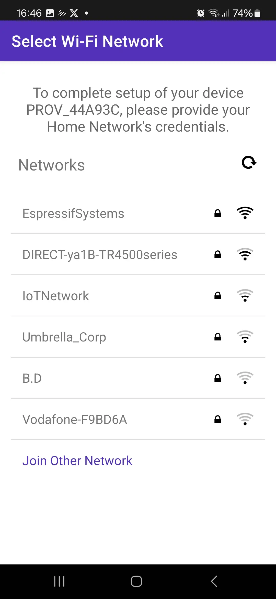
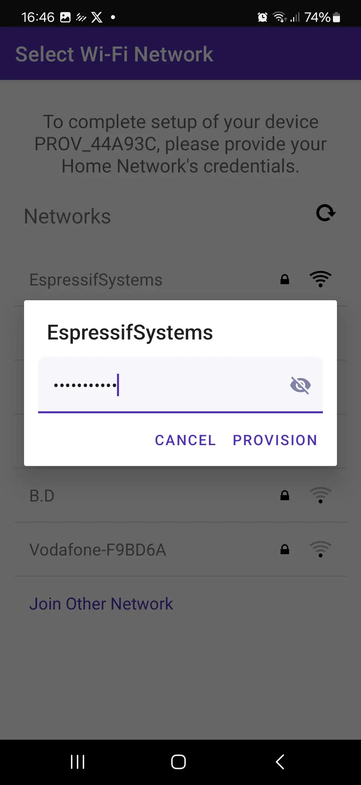
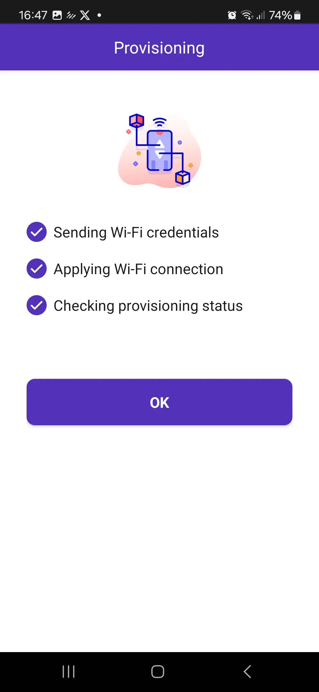

## Úkol 3: Wi-Fi a provisioning

---

Wi-Fi je jednou z nejdůležitějších vlastností IoT zařízení. **ESP32-C5** je výjimečné tím, že je prvním SoC od Espressifu s podporou **dual-band Wi-Fi 6** (2.4 GHz i 5 GHz). Pásmo 5 GHz bývá méně vytížené, což přináší vyšší propustnost a menší rušení.

V reálném produktu nemůžete přihlašovací údaje k Wi-Fi (SSID a heslo) zadrátovat přímo do zdrojového kódu, protože každý uživatel má jinou domácí síť. Místo toho se používá **Wi-Fi provisioning**. Provisioning umožňuje uživateli poslat do zařízení přihlašovací údaje k Wi-Fi pomocí mobilní aplikace přes sekundární kanál, typicky Bluetooth Low Energy (BLE).

V tomto úkolu použijeme k provisioningu naší desky mobilní aplikaci **ESP BLE Prov**. Každá deska vypíše v terminálu **QR kód**; jeho naskenováním aplikace zjistí, ke kterému zařízení se má připojit (každá deska má unikátní jméno), i tajný klíč potřebný pro komunikaci s ním, takže nemusíte nic vypisovat ani vybírat ze seznamu desítek zařízení. Přihlašovací údaje se uloží do NVS (Non-Volatile Storage), takže se deska po restartu automaticky znovu připojí.

> **Použijte projekt z Úkolu 2.** Otevřete stejnou složku `my_first_project`, kterou jste vytvořili v Úkolu 2, a nevytvářejte nový projekt. *Obsah* souboru `main/main.c` kompletně nahradíme logikou pro Wi-Fi a provisioning uvedenou níže. Kód pro LED z Úkolu 2 v tomto úkolu nepotřebujeme (nevadí, když ho z `main.c` smažete, závislost `led_strip` může v `idf_component.yml` klidně zůstat nepoužitá), LED vrátíme do hry až v Úkolu 5.

### 1. Zapnutí potřebných komponent

Budeme potřebovat komponentu `wifi_provisioning`. Protože je součástí ESP-IDF, stačí jen zajistit, že náš kód includuje správné hlavičkové soubory a správně inicializuje NVS.

Abychom mohli QR kód zobrazit v terminálu, přidáme ještě komponentu `espressif/qrcode` z component registry (stejně jako jsme v Úkolu 2 přidali `led_strip`):

```bash
idf.py add-dependency "espressif/qrcode^0.1.0"
```

### 2. Konfigurace pomocí menuconfig

BLE transport, který se chystáme použít (`wifi_prov_scheme_ble`), se do `wifi_provisioning` zkompiluje pouze tehdy, je-li zapnutý samotný Bluetooth, což ve výchozím stavu není. Spusťte:

```bash
idf.py menuconfig
```

Přejděte do:
- **Component config ---> Bluetooth**
  - **Bluetooth**: zapněte.
  - **Host**: vyberte `NimBLE`. ESP32-C5 má pouze BLE rádio a NimBLE je odlehčený host pouze pro BLE (těžší stack Bluedroid zde nepotřebujeme).
- **Partition Table**
  - **Partition Table**: vyberte `Single factory app (large), no OTA`. Kód NimBLE a provisioningu se už nevejde do výchozí 1MB aplikační partition.

Stiskněte `Q` pro ukončení a `Y` pro uložení.

> Nechcete klikat v menuconfigu? Vložte místo toho následující řádky do souboru `sdkconfig.defaults` v kořenovém adresáři projektu a znovu spusťte `idf.py set-target esp32c5`, aby se načetly:
> ```text
> CONFIG_BT_ENABLED=y
> CONFIG_BT_NIMBLE_ENABLED=y
> CONFIG_PARTITION_TABLE_SINGLE_APP_LARGE=y
> ```

### 3. Psaní kódu

Soubor `main/main.c` opět postavíme po částech, místo abychom na vás celý kód vysypali najednou.

#### 3.1 Kostra

```c
#include <stdio.h>
#include <string.h>
#include "freertos/FreeRTOS.h"
#include "freertos/task.h"
#include "freertos/event_groups.h"
#include "esp_log.h"
#include "esp_wifi.h"
#include "esp_event.h"
#include "esp_mac.h"
#include "nvs_flash.h"
#include "qrcode.h"
#include "wifi_provisioning/manager.h"
#include "wifi_provisioning/scheme_ble.h"

static const char *TAG = "provisioning";

// Proof-of-possession: the app gets it from the QR code, so the user never types it
#define PROV_POP "abcd1234"

// (A) One handler for every Wi-Fi / provisioning event we care about
static void event_handler(void* arg, esp_event_base_t event_base, int32_t event_id, void* event_data)
{
    // ...
}

void app_main(void)
{
    // (B) NVS must work before Wi-Fi or provisioning can store anything
    // (C) Bring up the networking stack
    // (D) Hook our event_handler into the events we need
    // (E) Start (or skip) provisioning, depending on whether we did it before
}
```

#### 3.2 Část (A): event handler

Provisioning i Wi-Fi hlásí, co se děje, přes systém událostí ESP-IDF (*events*), a ne přes návratové hodnoty. Díky tomu můžeme reagovat na věci jako „přišly přihlašovací údaje“ nebo „spojení bylo ztraceno“ kdykoli nastanou, a ne jen těsně po zavolání nějaké funkce.

```c
static void event_handler(void* arg, esp_event_base_t event_base, int32_t event_id, void* event_data)
{
    if (event_base == WIFI_PROV_EVENT) {
        switch (event_id) {
            case WIFI_PROV_START:
                ESP_LOGI(TAG, "Provisioning started");
                break;
            case WIFI_PROV_CRED_RECV:
                wifi_sta_config_t *wifi_sta_cfg = (wifi_sta_config_t *)event_data;
                ESP_LOGI(TAG, "Received Wi-Fi credentials\n\tSSID     : %s\n\tPassword : %s",
                         (const char *) wifi_sta_cfg->ssid,
                         (const char *) wifi_sta_cfg->password);
                break;
            case WIFI_PROV_CRED_SUCCESS:
                ESP_LOGI(TAG, "Provisioning successful");
                break;
            case WIFI_PROV_END:
                ESP_LOGI(TAG, "Provisioning completed. Deinitializing manager.");
                wifi_prov_mgr_deinit();
                break;
            default:
                break;
        }
    } else if (event_base == WIFI_EVENT && event_id == WIFI_EVENT_STA_START) {
        esp_wifi_connect();
    } else if (event_base == IP_EVENT && event_id == IP_EVENT_STA_GOT_IP) {
        ip_event_got_ip_t* event = (ip_event_got_ip_t*) event_data;
        ESP_LOGI(TAG, "Connected with IP Address:" IPSTR, IP2STR(&event->ip_info.ip));
    } else if (event_base == WIFI_EVENT && event_id == WIFI_EVENT_STA_DISCONNECTED) {
        ESP_LOGI(TAG, "Disconnected. Connecting to the AP again...");
        esp_wifi_connect();
    }
}
```

Obsluhujeme čtyři situace: provisioning začal, přišly přihlašovací údaje (abychom mohli vypsat, co jsme dostali), provisioning úspěšně skončil (takže můžeme provisioning manager vypnout, už ho nepotřebujeme) a běžné připojení, odpojení a opětovné připojení k Wi-Fi.

#### 3.3 Části (B)-(C): NVS a síť

```c
void app_main(void)
{
    // (B) Initialize NVS (needed for Wi-Fi and Provisioning to save data)
    esp_err_t ret = nvs_flash_init();
    if (ret == ESP_ERR_NVS_NO_FREE_PAGES || ret == ESP_ERR_NVS_NEW_VERSION_FOUND) {
        ESP_ERROR_CHECK(nvs_flash_erase());
        ret = nvs_flash_init();
    }
    ESP_ERROR_CHECK(ret);

    // (C) Initialize networking
    ESP_ERROR_CHECK(esp_netif_init());
    ESP_ERROR_CHECK(esp_event_loop_create_default());
    esp_netif_create_default_wifi_sta();
    wifi_init_config_t cfg = WIFI_INIT_CONFIG_DEFAULT();
    ESP_ERROR_CHECK(esp_wifi_init(&cfg));
```

NVS musí být inicializované jako první, protože se na něj spoléhá jak Wi-Fi (kalibrační data), tak provisioning manager (uložené přihlašovací údaje).

#### 3.4 Části (D)-(E): zapojení událostí a spuštění provisioningu

```c
    // (D) Register event handlers
    ESP_ERROR_CHECK(esp_event_handler_register(WIFI_PROV_EVENT, ESP_EVENT_ANY_ID, &event_handler, NULL));
    ESP_ERROR_CHECK(esp_event_handler_register(WIFI_EVENT, ESP_EVENT_ANY_ID, &event_handler, NULL));
    ESP_ERROR_CHECK(esp_event_handler_register(IP_EVENT, IP_EVENT_STA_GOT_IP, &event_handler, NULL));

    // (E) Start Wi-Fi Provisioning Manager
    wifi_prov_mgr_config_t config = {
        .scheme = wifi_prov_scheme_ble,
        .scheme_event_handler = WIFI_PROV_SCHEME_BLE_EVENT_HANDLER_FREE_BTDM
    };
    ESP_ERROR_CHECK(wifi_prov_mgr_init(config));

    bool provisioned = false;
    ESP_ERROR_CHECK(wifi_prov_mgr_is_provisioned(&provisioned));

    if (!provisioned) {
        ESP_LOGI(TAG, "Starting provisioning");
        // Unique name per board (last 3 bytes of the MAC), so many boards can be provisioned in one room
        uint8_t mac[6];
        ESP_ERROR_CHECK(esp_read_mac(mac, ESP_MAC_WIFI_STA));
        char service_name[16];
        snprintf(service_name, sizeof(service_name), "PROV_%02X%02X%02X", mac[3], mac[4], mac[5]);

        // Security 1: encrypted session, authenticated by the proof-of-possession from the QR code
        ESP_ERROR_CHECK(wifi_prov_mgr_start_provisioning(WIFI_PROV_SECURITY_1, PROV_POP, service_name, NULL));
        print_qr(service_name);
    } else {
        ESP_LOGI(TAG, "Already provisioned, starting Wi-Fi");
        wifi_prov_mgr_deinit();
        ESP_ERROR_CHECK(esp_wifi_set_mode(WIFI_MODE_STA));
        ESP_ERROR_CHECK(esp_wifi_start());
    }
}
```

Používáme **security 1**: spojení mezi telefonem a deskou je šifrované a telefon musí prokázat, že zná *proof-of-possession* (`PROV_POP`). Přesně to očekává aplikace ESP BLE Prov, když pracuje s QR kódem, proto security 0 končilo chybou „security does not match“.

QR kód je jen krátký JSON text se jménem zařízení, PoP a transportem (`ble`). Jeho generování a vykreslení pro nás není zajímavé, takže tady je pomocná funkce, kterou vložte do `main.c` nad `app_main`:

```c
static void print_qr(const char *service_name)
{
    char payload[150];
    snprintf(payload, sizeof(payload),
             "{\"ver\":\"v1\",\"name\":\"%s\",\"pop\":\"%s\",\"transport\":\"ble\"}",
             service_name, PROV_POP);
    ESP_LOGI(TAG, "Scan this QR code with the ESP BLE Prov app:");
    esp_qrcode_config_t qr_cfg = ESP_QRCODE_CONFIG_DEFAULT();
    esp_qrcode_generate(&qr_cfg, payload);
}
```

Příznak `provisioned` zajišťuje, že desku můžete flashovat opakovaně: manager zkontroluje, zda jsou v NVS uložené přihlašovací údaje, a pokud ano, provisioning úplně přeskočí a rovnou se připojí k Wi-Fi.

#### 3.5 Kompletní kód

Celý soubor (a odpovídající projekt, se kterým můžete svůj porovnat) najdete v [`examples/C5/assignment-03-wifi-provisioning`](../../../examples/C5/assignment-03-wifi-provisioning/):

```c
#include <stdio.h>
#include <string.h>
#include "freertos/FreeRTOS.h"
#include "freertos/task.h"
#include "freertos/event_groups.h"
#include "esp_log.h"
#include "esp_wifi.h"
#include "esp_event.h"
#include "esp_mac.h"
#include "nvs_flash.h"
#include "qrcode.h"
#include "wifi_provisioning/manager.h"
#include "wifi_provisioning/scheme_ble.h"

static const char *TAG = "provisioning";

// Proof-of-possession: the app gets it from the QR code, so the user never types it
#define PROV_POP "abcd1234"

// Print the QR code the ESP BLE Prov app scans (device name, PoP and transport).
// How the QR code is rendered is not important for this workshop.
static void print_qr(const char *service_name)
{
    char payload[150];
    snprintf(payload, sizeof(payload),
             "{\"ver\":\"v1\",\"name\":\"%s\",\"pop\":\"%s\",\"transport\":\"ble\"}",
             service_name, PROV_POP);
    ESP_LOGI(TAG, "Scan this QR code with the ESP BLE Prov app:");
    esp_qrcode_config_t qr_cfg = ESP_QRCODE_CONFIG_DEFAULT();
    esp_qrcode_generate(&qr_cfg, payload);
}

// Event handler for Wi-Fi events
static void event_handler(void* arg, esp_event_base_t event_base, int32_t event_id, void* event_data)
{
    if (event_base == WIFI_PROV_EVENT) {
        switch (event_id) {
            case WIFI_PROV_START:
                ESP_LOGI(TAG, "Provisioning started");
                break;
            case WIFI_PROV_CRED_RECV:
                wifi_sta_config_t *wifi_sta_cfg = (wifi_sta_config_t *)event_data;
                ESP_LOGI(TAG, "Received Wi-Fi credentials\n\tSSID     : %s\n\tPassword : %s",
                         (const char *) wifi_sta_cfg->ssid,
                         (const char *) wifi_sta_cfg->password);
                break;
            case WIFI_PROV_CRED_SUCCESS:
                ESP_LOGI(TAG, "Provisioning successful");
                break;
            case WIFI_PROV_END:
                ESP_LOGI(TAG, "Provisioning completed. Deinitializing manager.");
                wifi_prov_mgr_deinit();
                break;
            default:
                break;
        }
    } else if (event_base == WIFI_EVENT && event_id == WIFI_EVENT_STA_START) {
        esp_wifi_connect();
    } else if (event_base == IP_EVENT && event_id == IP_EVENT_STA_GOT_IP) {
        ip_event_got_ip_t* event = (ip_event_got_ip_t*) event_data;
        ESP_LOGI(TAG, "Connected with IP Address:" IPSTR, IP2STR(&event->ip_info.ip));
    } else if (event_base == WIFI_EVENT && event_id == WIFI_EVENT_STA_DISCONNECTED) {
        ESP_LOGI(TAG, "Disconnected. Connecting to the AP again...");
        esp_wifi_connect();
    }
}

void app_main(void)
{
    // 1. Initialize NVS (needed for Wi-Fi and Provisioning to save data)
    esp_err_t ret = nvs_flash_init();
    if (ret == ESP_ERR_NVS_NO_FREE_PAGES || ret == ESP_ERR_NVS_NEW_VERSION_FOUND) {
        ESP_ERROR_CHECK(nvs_flash_erase());
        ret = nvs_flash_init();
    }
    ESP_ERROR_CHECK(ret);

    // 2. Initialize networking
    ESP_ERROR_CHECK(esp_netif_init());
    ESP_ERROR_CHECK(esp_event_loop_create_default());
    esp_netif_create_default_wifi_sta();
    wifi_init_config_t cfg = WIFI_INIT_CONFIG_DEFAULT();
    ESP_ERROR_CHECK(esp_wifi_init(&cfg));

    // 3. Register event handlers
    ESP_ERROR_CHECK(esp_event_handler_register(WIFI_PROV_EVENT, ESP_EVENT_ANY_ID, &event_handler, NULL));
    ESP_ERROR_CHECK(esp_event_handler_register(WIFI_EVENT, ESP_EVENT_ANY_ID, &event_handler, NULL));
    ESP_ERROR_CHECK(esp_event_handler_register(IP_EVENT, IP_EVENT_STA_GOT_IP, &event_handler, NULL));

    // 4. Start Wi-Fi Provisioning Manager
    wifi_prov_mgr_config_t config = {
        .scheme = wifi_prov_scheme_ble,
        .scheme_event_handler = WIFI_PROV_SCHEME_BLE_EVENT_HANDLER_FREE_BTDM
    };
    ESP_ERROR_CHECK(wifi_prov_mgr_init(config));

    bool provisioned = false;
    ESP_ERROR_CHECK(wifi_prov_mgr_is_provisioned(&provisioned));

    if (!provisioned) {
        ESP_LOGI(TAG, "Starting provisioning");
        // Unique name per board (last 3 bytes of the MAC), so many boards can be provisioned in one room
        uint8_t mac[6];
        ESP_ERROR_CHECK(esp_read_mac(mac, ESP_MAC_WIFI_STA));
        char service_name[16];
        snprintf(service_name, sizeof(service_name), "PROV_%02X%02X%02X", mac[3], mac[4], mac[5]);

        // Security 1: encrypted session, authenticated by the proof-of-possession from the QR code
        ESP_ERROR_CHECK(wifi_prov_mgr_start_provisioning(WIFI_PROV_SECURITY_1, PROV_POP, service_name, NULL));
        print_qr(service_name);
    } else {
        ESP_LOGI(TAG, "Already provisioned, starting Wi-Fi");
        wifi_prov_mgr_deinit();
        ESP_ERROR_CHECK(esp_wifi_set_mode(WIFI_MODE_STA));
        ESP_ERROR_CHECK(esp_wifi_start());
    }
}
```

### 4. Build, flashování a monitorování

```bash
idf.py build flash monitor
```

### 5. Použití aplikace ESP BLE Prov

Pokud na této desce spouštíte kód poprvé, přejde do provisioning režimu a začne se inzerovat přes BLE.

1. Podívejte se na výstup v terminálu (monitoru). Deska vypíše QR kód a své jméno (`PROV_xxxxxx`, unikátní pro každou desku). Dbejte na to, aby okno terminálu bylo dostatečně velké a používalo neproporcionální písmo, jinak se QR kód zdeformuje. U terminálů s tmavým motivem může být potřeba lehce přiblížit, aby telefon kód přečetl.
2. Otevřete na telefonu aplikaci **ESP BLE Prov**. Uvidíte úvodní obrazovku s tlačítkem **Provision New Device**.

   

3. Klepněte na **Provision New Device** a namiřte fotoaparát na QR kód v terminálu. Aplikace se k desce připojí přes BLE sama, bez seznamu zařízení a bez zadávání PINu.

   

4. Ze seznamu vyberte svou Wi-Fi síť. ESP32-C5 podporuje sítě na 2.4 GHz i 5 GHz, takže se vám mohou zobrazit obě!

   

5. Zadejte heslo k Wi-Fi a klepněte na **Provision**.

   

6. Aplikace zobrazí průběh jednotlivých kroků provisioningu a skončí potvrzovací obrazovkou.

   

> Pokud se QR kód nedaří naskenovat, volba **I don't have a QR code** v aplikaci umožňuje vybrat `PROV_xxxxxx` ze seznamu BLE zařízení; aplikace se pak zeptá na proof-of-possession, kterým je `abcd1234`.

Podívejte se do terminálu! Měli byste vidět, jak deska přijímá přihlašovací údaje a připojuje se k vaší Wi-Fi síti. Pokud desku restartujete (stiskem tlačítka RESET), automaticky se znovu připojí, aniž by byla potřeba aplikace.

## Další krok

Když nám Wi-Fi funguje, můžeme prozkoumat vzdálené aktualizace!

[Úkol 4: OTA aktualizace](../assignment-4/)
