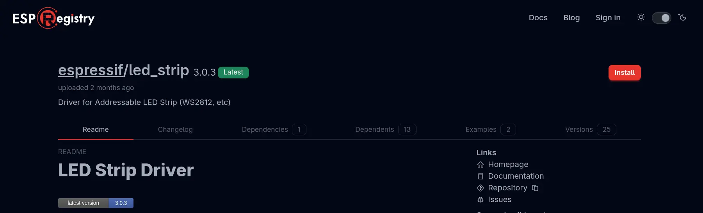

## Assignment 2: Basics: Hello World & LED

---

In this assignment, we will create our first project, verify that we can build and flash it to the ESP32-C5 board, and learn how to use components via the command line interface (CLI).

> **Keep this project around!** We will keep building on top of it: Assignment 3 (Wi-Fi provisioning) reuses this exact project folder, and Assignment 4 (OTA) continues from there. Only Assignments 5 (ESP-NOW) and 6 (LP-core) start from a clean project, because their code doesn't have much in common with what we write here. We'll remind you every time whether to reuse or start fresh.

### 1. Creating a new project

Instead of using a GUI wizard, we will use the ESP-IDF CLI. Open your ESP-IDF Terminal and navigate to a directory where you want to store your project.

```bash
idf.py create-project my_first_project
cd my_first_project
```

This creates a basic directory structure with a `CMakeLists.txt` and a `main` folder. The source file is named after the project, so this one is `main/my_first_project.c`.

### 2. Setting the target

Before building, we must tell ESP-IDF which chip we are compiling for. Run the following command:

```bash
idf.py set-target esp32c5
```

This generates a `sdkconfig` file with the default configuration for the ESP32-C5.

### 3. Adding a Component

We want to control the built-in RGB LED (WS2812) on our DevKit. This LED is connected to GPIO 27.
To control it easily, we will add the `led_strip` component from the Espressif Component Registry.

Run the following command in your project directory:

```bash
idf.py add-dependency "espressif/led_strip^3.0.3"
```

This creates a `main/idf_component.yml` file. When we build the project, ESP-IDF will automatically download the required component.

> **Tip:** The command above does the same thing as browsing the component on the web and clicking "Install" — you can look up any component beforehand on the [ESP Component Registry](https://components.espressif.com/) to check its README, examples, and dependencies.
>
> 
>
> 

### 4. Writing the Code

Rather than pasting a wall of code and hoping it makes sense, let's build it up piece by piece. Open `main/my_first_project.c` in VS Code — we'll replace its contents step by step.

#### 4.1 Skeleton

Here is the shape of what we're about to write. Keep this structure in mind as we fill it in:

```c
#include <stdio.h>
#include "freertos/FreeRTOS.h"
#include "freertos/task.h"
#include "led_strip.h"
#include "esp_log.h"
#include "esp_err.h"

// (A) A helper that sets up the WS2812 LED and returns a handle to it

led_strip_handle_t configure_led(void)
{
    // ... configuration goes here ...
}

void app_main(void)
{
    // (B) Create the LED handle
    // (C) Set it to a color
    // (D) Keep the task alive so the board doesn't just reboot
}
```

#### 4.2 Part (A): Configuring the LED

The `led_strip` driver needs two configuration structs: one describing *what* is connected (which GPIO, how many LEDs, what color order), and one describing *how* to drive it (the RMT peripheral is used to generate the precise timing WS2812 LEDs need).

```c
/* RMT tick rate. A WS2812 bit lasts 1.25 us, so 10 MHz is about 10x finer. */
#define LED_STRIP_RMT_RES_HZ  (10 * 1000 * 1000)
static const char *TAG = "workshop";

/* Set up RMT (it times the data line) and the one built-in LED. */
led_strip_handle_t configure_led(void)
{
    led_strip_config_t strip_config = {
        .strip_gpio_num = 27,
        .max_leds = 1,
        .color_component_format = LED_STRIP_COLOR_COMPONENT_FMT_GRB, /* WS2812 wants G, then R, then B */
        .led_model = LED_MODEL_WS2812,
        .flags.invert_out = false, /* true only if something flips the data line */
    };

    led_strip_rmt_config_t rmt_config = {
        .clk_src = RMT_CLK_SRC_DEFAULT,
        .resolution_hz = LED_STRIP_RMT_RES_HZ,
        .mem_block_symbols = 0, /* 0 = let the driver pick the buffer size */
        .flags.with_dma = false, /* one LED is a few bytes; DMA is for long strips */
    };

    led_strip_handle_t led_strip;
    /* Create the driver. From here the handle is the LED. */
    ESP_ERROR_CHECK(led_strip_new_rmt_device(&strip_config, &rmt_config, &led_strip));
    ESP_LOGI(TAG, "LED strip initialized successfully");
    return led_strip;
}
```

Put this above `app_main`. There is exactly one LED on the devkit (`.max_leds = 1`), and it is wired to GPIO 27.

#### 4.3 Parts (B)-(D): `app_main`

```c
void app_main(void)
{
    ESP_LOGI(TAG, "Hello ESP32-C5!");

    // (B) Create the LED handle
    led_strip_handle_t led_strip = configure_led();

    // (C) Set color to Red. set_pixel writes RAM; refresh sends that buffer to the LED.
    ESP_ERROR_CHECK(led_strip_set_pixel(led_strip, 0, 20, 0, 0));
    ESP_ERROR_CHECK(led_strip_refresh(led_strip));
    ESP_LOGI(TAG, "LED set to Red");

    // (D) app_main must not return, otherwise the system considers the app finished
    while (1) {
        vTaskDelay(1000 / portTICK_PERIOD_MS); /* sleep 1 s instead of spinning */
    }
}
```

`led_strip_set_pixel` only updates an in-memory buffer; nothing is sent to the LED until you call `led_strip_refresh`. The three numbers (`20, 0, 0`) are red, green, and blue brightness (0-255 each) — we keep them low so the LED isn't blinding.

#### 4.4 Complete code

Putting it all together gives you the full `main/my_first_project.c`. If you'd rather not type it out, the finished project also lives in [`examples/C5/assignment-02-led-components`](../../../examples/C5/assignment-02-led-components/) — you can diff your file against it or copy it directly.

```c
#include <stdio.h>
#include "freertos/FreeRTOS.h"
#include "freertos/task.h"
#include "led_strip.h"
#include "esp_log.h"
#include "esp_err.h"

/* RMT tick rate. A WS2812 bit lasts 1.25 us, so 10 MHz is about 10x finer. */
#define LED_STRIP_RMT_RES_HZ  (10 * 1000 * 1000)
static const char *TAG = "workshop";

/* Set up RMT (it times the data line) and the one built-in LED. */
led_strip_handle_t configure_led(void)
{
    led_strip_config_t strip_config = {
        .strip_gpio_num = 27,
        .max_leds = 1,
        .color_component_format = LED_STRIP_COLOR_COMPONENT_FMT_GRB, /* WS2812 wants G, then R, then B */
        .led_model = LED_MODEL_WS2812,
        .flags.invert_out = false, /* true only if something flips the data line */
    };

    led_strip_rmt_config_t rmt_config = {
        .clk_src = RMT_CLK_SRC_DEFAULT,
        .resolution_hz = LED_STRIP_RMT_RES_HZ,
        .mem_block_symbols = 0, /* 0 = let the driver pick the buffer size */
        .flags.with_dma = false, /* one LED is a few bytes; DMA is for long strips */
    };

    led_strip_handle_t led_strip;
    /* Create the driver. From here the handle is the LED. */
    ESP_ERROR_CHECK(led_strip_new_rmt_device(&strip_config, &rmt_config, &led_strip));
    ESP_LOGI(TAG, "LED strip initialized successfully");
    return led_strip;
}

void app_main(void)
{
    ESP_LOGI(TAG, "Hello ESP32-C5!");

    led_strip_handle_t led_strip = configure_led();

    /* set_pixel writes RAM; refresh sends that buffer to the LED. */
    ESP_ERROR_CHECK(led_strip_set_pixel(led_strip, 0, 20, 0, 0));
    ESP_ERROR_CHECK(led_strip_refresh(led_strip));
    ESP_LOGI(TAG, "LED set to Red");

    while (1) {
        vTaskDelay(1000 / portTICK_PERIOD_MS); /* sleep 1 s instead of spinning */
    }
}
```

### 5. Building, Flashing, and Monitoring

Now we are ready to build the firmware, flash it to the board, and monitor the serial output. You can do all three in a single command!

Connect your ESP32-C5 to your computer using the USB Type-C port labeled "UART". Then run:

```bash
idf.py build flash monitor
```

* `build`: Compiles the code.
* `flash`: Uploads the binary to the board. ESP-IDF usually auto-detects the serial port.
* `monitor`: Opens a serial terminal to view the output.

> **Tip:** To exit the monitor, press `Ctrl + ]`.

If everything is correct, the built-in LED should light up red, and you will see "Hello ESP32-C5!" in your terminal.

## Next step

Now that our hardware is working, let's explore one of the most important features of the C5: Wi-Fi! We'll keep editing this very same project.

[Assignment 3: Wi-Fi & Provisioning](../assignment-3/)
