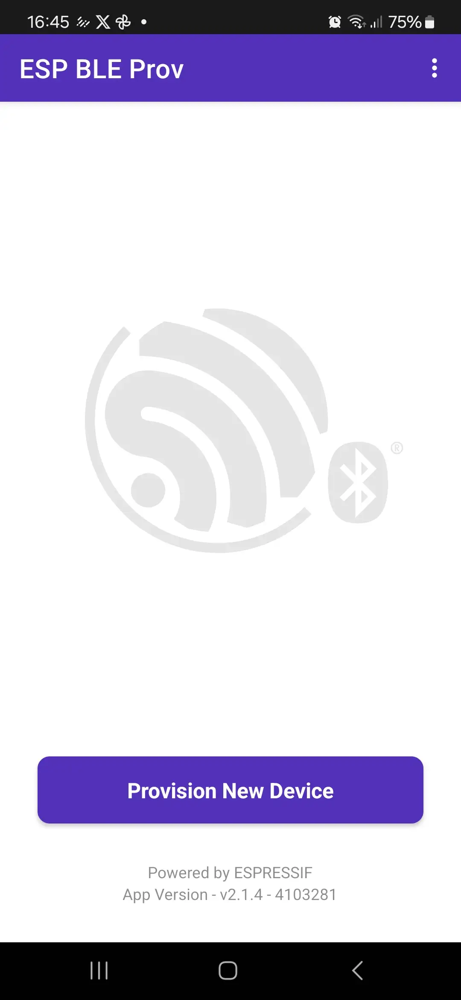
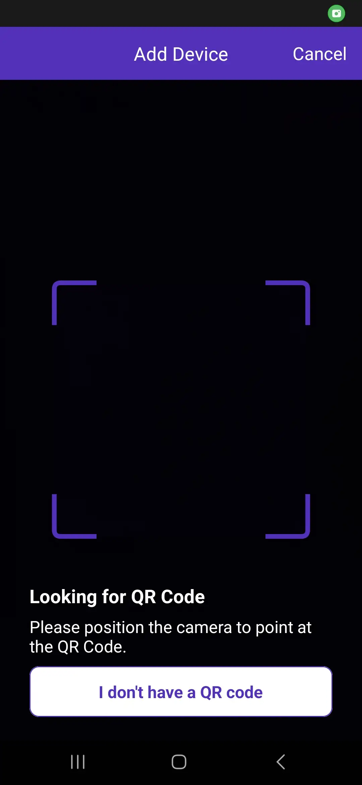

## Assignment 3: Wi-Fi & Provisioning

---

Wi-Fi is one of the most essential features for an IoT device. The **ESP32-C5** is special because it is Espressif's first SoC to support **dual-band Wi-Fi 6** (both 2.4 GHz and 5 GHz). The 5 GHz band is generally less crowded, leading to higher throughput and reduced interference.

In a real-world product, you cannot hardcode the Wi-Fi credentials (SSID and password) in your source code because every user has a different home network. Instead, you use **Wi-Fi Provisioning**. Provisioning allows a user to send their Wi-Fi credentials to the device using a mobile app over a secondary channel, typically Bluetooth Low Energy (BLE).

In this assignment, we will use the **ESP BLE Prov** mobile application to provision our board. Each board prints a **QR code** in the terminal; scanning it tells the app which device to connect to (every board gets a unique name) and the secret needed to talk to it, so there is nothing to type or pick from a list of dozens of devices. The credentials will be saved in NVS (Non-Volatile Storage) so the board automatically reconnects after a reboot.

> **Reuse the Assignment 2 project.** Open the same `my_first_project` folder you created in Assignment 2 — don't create a new one. We're going to replace the *contents* of `main/my_first_project.c` entirely with the Wi-Fi/provisioning logic below. We won't need the LED code from Assignment 2 in this particular assignment (no harm in deleting it from that file, the `led_strip` dependency can simply stay unused in `idf_component.yml`) — we'll bring the LED back in Assignment 5.

### 1. Enabling required components

We will need the `wifi_provisioning` component. Because it is part of ESP-IDF, we just need to ensure our code includes the right headers and initializes NVS properly.

To show the QR code in the terminal, we also add the `espressif/qrcode` component from the component registry (the same way we added `led_strip` in Assignment 2):

```bash
idf.py add-dependency "espressif/qrcode^0.1.0"
```

### 2. Configuration via menuconfig

The BLE transport we're about to use (`wifi_prov_scheme_ble`) is only compiled into `wifi_provisioning` when Bluetooth itself is enabled - and it isn't, by default. Run:

```bash
idf.py menuconfig
```

Navigate to:
- **Component config ---> Bluetooth**
  - **Bluetooth**: enable it.
  - **Host**: select `NimBLE` — the ESP32-C5 only has a BLE radio, and NimBLE is the lightweight BLE-only host (no need for the heavier Bluedroid stack here).
- **Partition Table**
  - **Partition Table**: select `Single factory app (large), no OTA` — the NimBLE + provisioning code no longer fits in the default 1 MB app partition.

Press `Q` to quit and `Y` to save.

> Prefer not to click through menuconfig? Drop this into a `sdkconfig.defaults` file in your project root instead, then re-run `idf.py set-target esp32c5` so it picks it up:
> ```text
> CONFIG_BT_ENABLED=y
> CONFIG_BT_NIMBLE_ENABLED=y
> CONFIG_PARTITION_TABLE_SINGLE_APP_LARGE=y
> ```

### 3. Writing the Code

Let's build `main/my_first_project.c` piece by piece instead of dropping the whole thing on you at once.

#### 3.1 Skeleton

```c
#include <stdio.h>
#include <string.h>
#include "freertos/FreeRTOS.h"
#include "freertos/task.h"
#include "freertos/event_groups.h"
#include "esp_log.h"
#include "esp_wifi.h"
#include "esp_event.h"
#include "esp_mac.h"
#include "nvs_flash.h"
#include "qrcode.h"
#include "wifi_provisioning/manager.h"
#include "wifi_provisioning/scheme_ble.h"

static const char *TAG = "provisioning";

// Proof-of-possession: the app gets it from the QR code, so the user never types it
#define PROV_POP "abcd1234"

// (A) One handler for every Wi-Fi / provisioning event we care about
static void event_handler(void* arg, esp_event_base_t event_base, int32_t event_id, void* event_data)
{
    // ...
}

void app_main(void)
{
    // (B) NVS must work before Wi-Fi or provisioning can store anything
    // (C) Bring up the networking stack
    // (D) Hook our event_handler into the events we need
    // (E) Start (or skip) provisioning, depending on whether we did it before
}
```

#### 3.2 Part (A): the event handler

Provisioning and Wi-Fi both report what's happening through the ESP-IDF event system, rather than through return values — this lets us react to things like "credentials received" or "disconnected" whenever they happen, not just right after a function call.

```c
static void event_handler(void* arg, esp_event_base_t event_base, int32_t event_id, void* event_data)
{
    if (event_base == WIFI_PROV_EVENT) {
        switch (event_id) {
            case WIFI_PROV_START:
                ESP_LOGI(TAG, "Provisioning started");
                break;
            case WIFI_PROV_CRED_RECV:
                wifi_sta_config_t *wifi_sta_cfg = (wifi_sta_config_t *)event_data;
                ESP_LOGI(TAG, "Received Wi-Fi credentials\n\tSSID     : %s\n\tPassword : %s",
                         (const char *) wifi_sta_cfg->ssid,
                         (const char *) wifi_sta_cfg->password);
                break;
            case WIFI_PROV_CRED_SUCCESS:
                ESP_LOGI(TAG, "Provisioning successful");
                break;
            case WIFI_PROV_END:
                ESP_LOGI(TAG, "Provisioning completed. Deinitializing manager.");
                wifi_prov_mgr_deinit();
                break;
            default:
                break;
        }
    } else if (event_base == WIFI_EVENT && event_id == WIFI_EVENT_STA_START) {
        esp_wifi_connect();
    } else if (event_base == IP_EVENT && event_id == IP_EVENT_STA_GOT_IP) {
        ip_event_got_ip_t* event = (ip_event_got_ip_t*) event_data;
        ESP_LOGI(TAG, "Connected with IP Address:" IPSTR, IP2STR(&event->ip_info.ip));
    } else if (event_base == WIFI_EVENT && event_id == WIFI_EVENT_STA_DISCONNECTED) {
        ESP_LOGI(TAG, "Disconnected. Connecting to the AP again...");
        esp_wifi_connect();
    }
}
```

The four cases we handle are: provisioning started, credentials received (so we can log what we got), provisioning finished successfully (so we can shut the provisioning manager down — it's no longer needed), and plain Wi-Fi connect/disconnect/reconnect bookkeeping.

#### 3.3 Part (B)-(C): NVS and networking

```c
void app_main(void)
{
    // (B) Initialize NVS (needed for Wi-Fi and Provisioning to save data)
    esp_err_t ret = nvs_flash_init();
    if (ret == ESP_ERR_NVS_NO_FREE_PAGES || ret == ESP_ERR_NVS_NEW_VERSION_FOUND) {
        ESP_ERROR_CHECK(nvs_flash_erase());
        ret = nvs_flash_init();
    }
    ESP_ERROR_CHECK(ret);

    // (C) Initialize networking
    ESP_ERROR_CHECK(esp_netif_init());
    ESP_ERROR_CHECK(esp_event_loop_create_default());
    esp_netif_create_default_wifi_sta();
    wifi_init_config_t cfg = WIFI_INIT_CONFIG_DEFAULT();
    ESP_ERROR_CHECK(esp_wifi_init(&cfg));
```

NVS has to come first because both Wi-Fi (calibration data) and the provisioning manager (saved credentials) rely on it being ready.

#### 3.4 Part (D)-(E): wiring up events and starting provisioning

```c
    // (D) Register event handlers
    ESP_ERROR_CHECK(esp_event_handler_register(WIFI_PROV_EVENT, ESP_EVENT_ANY_ID, &event_handler, NULL));
    ESP_ERROR_CHECK(esp_event_handler_register(WIFI_EVENT, ESP_EVENT_ANY_ID, &event_handler, NULL));
    ESP_ERROR_CHECK(esp_event_handler_register(IP_EVENT, IP_EVENT_STA_GOT_IP, &event_handler, NULL));

    // (E) Start Wi-Fi Provisioning Manager
    wifi_prov_mgr_config_t config = {
        .scheme = wifi_prov_scheme_ble,
        .scheme_event_handler = WIFI_PROV_SCHEME_BLE_EVENT_HANDLER_FREE_BTDM
    };
    ESP_ERROR_CHECK(wifi_prov_mgr_init(config));

    bool provisioned = false;
    ESP_ERROR_CHECK(wifi_prov_mgr_is_provisioned(&provisioned));

    if (!provisioned) {
        ESP_LOGI(TAG, "Starting provisioning");
        // Unique name per board (last 3 bytes of the MAC), so many boards can be provisioned in one room
        uint8_t mac[6];
        ESP_ERROR_CHECK(esp_read_mac(mac, ESP_MAC_WIFI_STA));
        char service_name[16];
        snprintf(service_name, sizeof(service_name), "PROV_%02X%02X%02X", mac[3], mac[4], mac[5]);

        // Security 1: encrypted session, authenticated by the proof-of-possession from the QR code
        ESP_ERROR_CHECK(wifi_prov_mgr_start_provisioning(WIFI_PROV_SECURITY_1, PROV_POP, service_name, NULL));
        print_qr(service_name);
    } else {
        ESP_LOGI(TAG, "Already provisioned, starting Wi-Fi");
        wifi_prov_mgr_deinit();
        ESP_ERROR_CHECK(esp_wifi_set_mode(WIFI_MODE_STA));
        ESP_ERROR_CHECK(esp_wifi_start());
    }
}
```

We use **security 1**: the session between the phone and the board is encrypted, and the phone must prove it knows the *proof-of-possession* (`PROV_POP`). The ESP BLE Prov app expects exactly this when it works from a QR code, which is why security 0 produced a "security does not match" error.

The QR code is just a small JSON text with the device name, the PoP and the transport (`ble`). Generating and drawing it is not interesting for us, so here is the helper to paste into `main/my_first_project.c` above `app_main`:

```c
static void print_qr(const char *service_name)
{
    char payload[150];
    snprintf(payload, sizeof(payload),
             "{\"ver\":\"v1\",\"name\":\"%s\",\"pop\":\"%s\",\"transport\":\"ble\"}",
             service_name, PROV_POP);
    ESP_LOGI(TAG, "Scan this QR code with the ESP BLE Prov app:");
    esp_qrcode_config_t qr_cfg = ESP_QRCODE_CONFIG_DEFAULT();
    esp_qrcode_generate(&qr_cfg, payload);
}
```

The `provisioned` flag is what makes this safe to flash repeatedly: the manager checks NVS for stored credentials and, if it finds them, skips provisioning entirely and just connects straight to Wi-Fi.

#### 3.5 Complete code

The full file (and the matching project you can diff against) is available at [`examples/C5/assignment-03-wifi-provisioning`](../../../examples/C5/assignment-03-wifi-provisioning/):

```c
#include <stdio.h>
#include <string.h>
#include "freertos/FreeRTOS.h"
#include "freertos/task.h"
#include "freertos/event_groups.h"
#include "esp_log.h"
#include "esp_wifi.h"
#include "esp_event.h"
#include "esp_mac.h"
#include "nvs_flash.h"
#include "qrcode.h"
#include "wifi_provisioning/manager.h"
#include "wifi_provisioning/scheme_ble.h"

static const char *TAG = "provisioning";

// Proof-of-possession: the app gets it from the QR code, so the user never types it
#define PROV_POP "abcd1234"

// Print the QR code the ESP BLE Prov app scans (device name, PoP and transport).
// How the QR code is rendered is not important for this workshop.
static void print_qr(const char *service_name)
{
    char payload[150];
    snprintf(payload, sizeof(payload),
             "{\"ver\":\"v1\",\"name\":\"%s\",\"pop\":\"%s\",\"transport\":\"ble\"}",
             service_name, PROV_POP);
    ESP_LOGI(TAG, "Scan this QR code with the ESP BLE Prov app:");
    esp_qrcode_config_t qr_cfg = ESP_QRCODE_CONFIG_DEFAULT();
    esp_qrcode_generate(&qr_cfg, payload);
}

// Event handler for Wi-Fi events
static void event_handler(void* arg, esp_event_base_t event_base, int32_t event_id, void* event_data)
{
    if (event_base == WIFI_PROV_EVENT) {
        switch (event_id) {
            case WIFI_PROV_START:
                ESP_LOGI(TAG, "Provisioning started");
                break;
            case WIFI_PROV_CRED_RECV:
                wifi_sta_config_t *wifi_sta_cfg = (wifi_sta_config_t *)event_data;
                ESP_LOGI(TAG, "Received Wi-Fi credentials\n\tSSID     : %s\n\tPassword : %s",
                         (const char *) wifi_sta_cfg->ssid,
                         (const char *) wifi_sta_cfg->password);
                break;
            case WIFI_PROV_CRED_SUCCESS:
                ESP_LOGI(TAG, "Provisioning successful");
                break;
            case WIFI_PROV_END:
                ESP_LOGI(TAG, "Provisioning completed. Deinitializing manager.");
                wifi_prov_mgr_deinit();
                break;
            default:
                break;
        }
    } else if (event_base == WIFI_EVENT && event_id == WIFI_EVENT_STA_START) {
        esp_wifi_connect();
    } else if (event_base == IP_EVENT && event_id == IP_EVENT_STA_GOT_IP) {
        ip_event_got_ip_t* event = (ip_event_got_ip_t*) event_data;
        ESP_LOGI(TAG, "Connected with IP Address:" IPSTR, IP2STR(&event->ip_info.ip));
    } else if (event_base == WIFI_EVENT && event_id == WIFI_EVENT_STA_DISCONNECTED) {
        ESP_LOGI(TAG, "Disconnected. Connecting to the AP again...");
        esp_wifi_connect();
    }
}

void app_main(void)
{
    // 1. Initialize NVS (needed for Wi-Fi and Provisioning to save data)
    esp_err_t ret = nvs_flash_init();
    if (ret == ESP_ERR_NVS_NO_FREE_PAGES || ret == ESP_ERR_NVS_NEW_VERSION_FOUND) {
        ESP_ERROR_CHECK(nvs_flash_erase());
        ret = nvs_flash_init();
    }
    ESP_ERROR_CHECK(ret);

    // 2. Initialize networking
    ESP_ERROR_CHECK(esp_netif_init());
    ESP_ERROR_CHECK(esp_event_loop_create_default());
    esp_netif_create_default_wifi_sta();
    wifi_init_config_t cfg = WIFI_INIT_CONFIG_DEFAULT();
    ESP_ERROR_CHECK(esp_wifi_init(&cfg));

    // 3. Register event handlers
    ESP_ERROR_CHECK(esp_event_handler_register(WIFI_PROV_EVENT, ESP_EVENT_ANY_ID, &event_handler, NULL));
    ESP_ERROR_CHECK(esp_event_handler_register(WIFI_EVENT, ESP_EVENT_ANY_ID, &event_handler, NULL));
    ESP_ERROR_CHECK(esp_event_handler_register(IP_EVENT, IP_EVENT_STA_GOT_IP, &event_handler, NULL));

    // 4. Start Wi-Fi Provisioning Manager
    wifi_prov_mgr_config_t config = {
        .scheme = wifi_prov_scheme_ble,
        .scheme_event_handler = WIFI_PROV_SCHEME_BLE_EVENT_HANDLER_FREE_BTDM
    };
    ESP_ERROR_CHECK(wifi_prov_mgr_init(config));

    bool provisioned = false;
    ESP_ERROR_CHECK(wifi_prov_mgr_is_provisioned(&provisioned));

    if (!provisioned) {
        ESP_LOGI(TAG, "Starting provisioning");
        // Unique name per board (last 3 bytes of the MAC), so many boards can be provisioned in one room
        uint8_t mac[6];
        ESP_ERROR_CHECK(esp_read_mac(mac, ESP_MAC_WIFI_STA));
        char service_name[16];
        snprintf(service_name, sizeof(service_name), "PROV_%02X%02X%02X", mac[3], mac[4], mac[5]);

        // Security 1: encrypted session, authenticated by the proof-of-possession from the QR code
        ESP_ERROR_CHECK(wifi_prov_mgr_start_provisioning(WIFI_PROV_SECURITY_1, PROV_POP, service_name, NULL));
        print_qr(service_name);
    } else {
        ESP_LOGI(TAG, "Already provisioned, starting Wi-Fi");
        wifi_prov_mgr_deinit();
        ESP_ERROR_CHECK(esp_wifi_set_mode(WIFI_MODE_STA));
        ESP_ERROR_CHECK(esp_wifi_start());
    }
}
```

### 4. Build, Flash, and Monitor

```bash
idf.py build flash monitor
```

### 5. Using the ESP BLE Prov app

If this is your first time running the code on this board, it will start provisioning mode and advertise over BLE.

1. Look at the terminal (monitor) output. The board prints a QR code and its name (`PROV_xxxxxx`, unique for each board). Make sure the terminal window is large enough and uses a monospace font, otherwise the QR code gets distorted. Dark-theme terminals may need to be zoomed in a bit for the phone to read the code.
2. Open the **ESP BLE Prov** app on your phone. You'll see its home screen with a **Provision New Device** button.

   {: width="240" }

3. Tap **Provision New Device** and point the camera at the QR code in your terminal. The app connects to your board over BLE by itself - no device list and no PIN to type.

   {: width="240" }

4. Select your Wi-Fi network from the list — the ESP32-C5 supports both 2.4 GHz and 5 GHz networks, so you may see both show up!

   {: width="240" }

5. Enter the Wi-Fi password and tap **Provision**.

   {: width="240" }

6. The app will show you the provisioning steps completing, finishing with a confirmation screen.

   {: width="240" }

> If the QR code cannot be scanned, the app's **I don't have a QR code** option lets you pick `PROV_xxxxxx` from the BLE device list; it will then ask for the proof-of-possession, which is `abcd1234`.

Look at your terminal! You should see the board receiving the credentials and connecting to your Wi-Fi network. If you restart the board (press the RESET button), it will automatically reconnect without needing the app again.

## Next step

Now that we have Wi-Fi working, we can explore remote updates!

[Assignment 4: OTA Updates](../assignment-4/)
