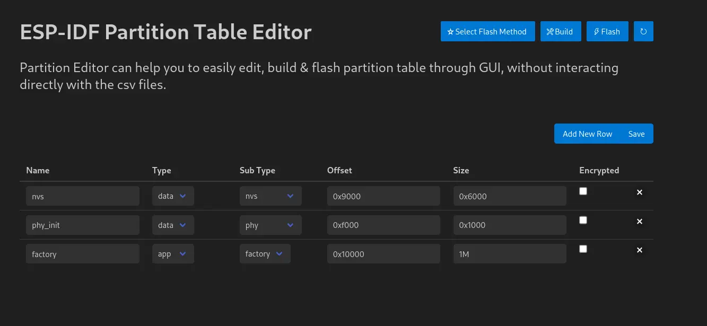
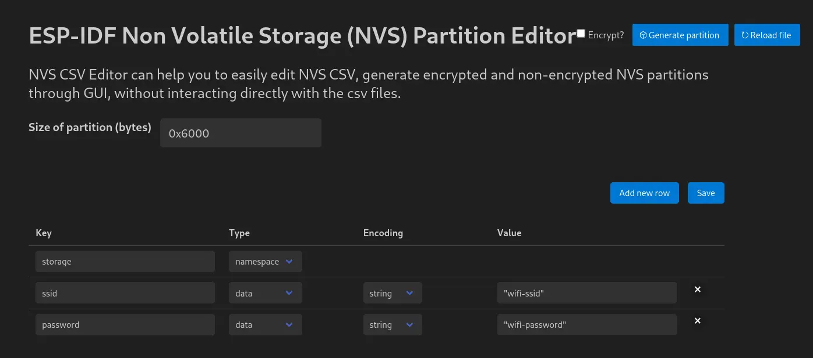
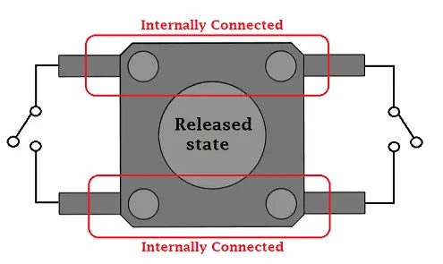

## Assignment 4: Over-The-Air (OTA) Updates

---

> **Note:** This is an optional chapter. If time is running short, you may skip directly to [Assignment 5: ESP-NOW Chat Room](../assignment-5/).

In a real-world deployment, you won't have physical access to a USB port to flash new firmware. Over-The-Air (OTA) updates allow you to download and install new firmware over a network connection like Wi-Fi.

**How OTA works on the ESP32 in a nutshell:** the flash holds two app slots instead of one. The device always runs from one of them (the *active* slot) and never overwrites it. A new firmware is written into the *other*, inactive slot, and only after it has been downloaded completely (and verified) does the device switch a small "boot from this slot" record and reboot into it. If anything goes wrong during the download, the old firmware is still intact and keeps running. With rollback enabled (see the bonus at the end), the bootloader goes one step further: if the new firmware doesn't confirm that it works after booting, the bootloader falls back to the previous slot, so a bad update can't leave the device bricked.

> **Keep reusing the project.** Continue in the same project you provisioned in Assignment 3 — OTA needs a device that can already connect to your Wi-Fi. If that step stored credentials in NVS, those are reused; if not, the board joins the `ESP32-WS` workshop network directly. A second board, flashed with the server project, sits on that same network with a fixed address and hosts the update file. We'll replace `main/my_first_project.c` again, but keep `idf_component.yml` as-is: it already pulls in `led_strip` from Assignment 2, and we're about to need it again.

### 1. Partition Tables

To support OTA, the flash memory of the ESP32-C5 must be divided into specific regions called partitions. A typical OTA partition table includes:
- **nvs**: Non-Volatile Storage for Wi-Fi credentials and calibration data.
- **otadata**: Stores information about which app partition is currently active.
- **phy_init**: Factory-calibrated radio data.
- **ota_0**: The first app slot - this is what gets flashed initially.
- **ota_1**: The second app slot, where new firmware gets downloaded to.

When an OTA update occurs, the device downloads the new firmware into the inactive partition (whichever of `ota_0`/`ota_1` isn't currently running). If the download is successful, it updates the `otadata` partition to point there and reboots.

We define this layout in a file named `partitions.csv` in our project root:

```text
# Name,   Type, SubType, Offset,  Size, Flags
nvs,      data, nvs,     ,        0x4000,
otadata,  data, ota,     ,        0x2000,
phy_init, data, phy,     ,        0x1000,
ota_0,    app,  ota_0,   ,        1500K,
ota_1,    app,  ota_1,   ,        1500K,
```

1500K per slot gives the OTA/TLS/Wi-Fi/LED code in this assignment comfortable headroom (the actual binary is roughly 1.1 MB) while still leaving two full slots on a 4 MB flash chip.

> **Tip:** If you'd rather not edit CSV files by hand, the ESP-IDF VS Code extension ships GUI editors for both the partition table and NVS contents.
>
> 
>
> 

### 2. Configuration via menuconfig

To tell ESP-IDF to use our custom partition table, run:

```bash
idf.py menuconfig
```

Navigate to:
- **Partition Table**
  - **Partition Table**: Select `Custom partition table CSV`
  - **Custom partition CSV file**: Type `partitions.csv`
- **Serial Flasher Config**
  - **Flash size**: Select `4 MB` — two 1500K app slots plus `nvs`/`otadata`/`phy_init` no longer fit in the default 2 MB assumption.
- **Component config**
  - **ESP HTTPS OTA**
    - **Allow HTTP for OTA**: Enable it. The server in this assignment speaks plain HTTP, and `esp_https_ota()` refuses an `http://` URL until this option is on. Leave it off if you later point `.url` at a real HTTPS host.

Press `Q` to quit and `Y` to save.

> If you'd rather not click through menuconfig for this, drop these settings into a `sdkconfig.defaults` file in your project root instead:
> ```text
> CONFIG_PARTITION_TABLE_CUSTOM=y
> CONFIG_PARTITION_TABLE_CUSTOM_FILENAME="partitions.csv"
> CONFIG_PARTITION_TABLE_FILENAME="partitions.csv"
> CONFIG_ESPTOOLPY_FLASHSIZE_4MB=y
> CONFIG_ESP_HTTPS_OTA_ALLOW_HTTP=y
> ```
>
> `CONFIG_ESP_HTTPS_OTA_ALLOW_HTTP` lets `esp_https_ota()` download from the plain HTTP server on the companion board. Leave it off if you later point `.url` at a real HTTPS host.

### 3. Connecting a Button

Instead of updating itself the moment it boots, our board will wait for you to press a physical button before it starts downloading anything. This is both safer (no surprise downloads mid-demo) and a good excuse to learn basic GPIO input — and we'll keep reusing this exact button in Assignments 5 and 6, so it's worth wiring up carefully now.

Any simple 2-pin or 4-pin tactile push button works. On a 4-pin button, the two pins on each short side are internally connected to each other:



Wire it like this:

- One leg of the button -> **3V3**
- The other leg of the button -> **GPIO0**
- A pull-down resistor (e.g. 10 kΩ) between **GPIO0** and **GND**

With the pull-down resistor in place, `GPIO0` reads **LOW** while the button is released, and **HIGH** while it's pressed (because the button then connects it straight to 3V3).

> `GPIO0` is also a boot-mode strapping pin on many ESP32 chips, but that only matters for the brief instant right at power-up/reset. Pressing the button during normal operation (which is all we ever do here) has no effect on that.

### 4. Writing the Code

As before, let's build this up instead of pasting it all at once.

#### 4.1 Skeleton

```c
#include <stdio.h>
#include "freertos/FreeRTOS.h"
#include "freertos/task.h"
#include "esp_system.h"
#include "esp_event.h"
#include "esp_log.h"
#include "esp_https_ota.h"
#include "esp_http_client.h"
#include "esp_wifi.h"
#include "esp_netif.h"
#include "esp_crt_bundle.h"
#include "nvs_flash.h"
#include "driver/gpio.h"
#include "led_strip.h"

#define BUTTON_GPIO       GPIO_NUM_0
#define LED_GPIO          27
/* Workshop fallback only. NEVER hardcode a Wi-Fi SSID and password in production;
   use provisioning (Assignment 3) so each device gets its own credentials. */
#define FALLBACK_SSID     "ESP32-WS"
#define FALLBACK_PASSWORD "ESP32-WS"

static const char *TAG = "ota_example";

// (A) LED helpers - reused from Assignment 2
// (B) Button GPIO setup
// (C) Wi-Fi event handler - also updates the LED
// (D) A task that polls the button and wakes up the OTA task
// (E) The OTA task itself - now waits for a notification instead of running immediately
// (F) app_main wires everything together
```

#### 4.2 Part (A)-(B): LED and button setup

```c
static led_strip_handle_t led_strip;
static TaskHandle_t s_ota_task_handle = NULL;

static void led_set_color(uint8_t r, uint8_t g, uint8_t b)
{
    /* Same two-step push as in Assignment 2: RAM first, then the wire. */
    led_strip_set_pixel(led_strip, 0, r, g, b);
    led_strip_refresh(led_strip);
}

static void configure_led(void)
{
    led_strip_config_t strip_config = {
        .strip_gpio_num = LED_GPIO, /* the built-in LED, same as in Assignment 2 */
        .max_leds = 1,
        .color_component_format = LED_STRIP_COLOR_COMPONENT_FMT_GRB,
        .led_model = LED_MODEL_WS2812,
        .flags.invert_out = false,
    };
    led_strip_rmt_config_t rmt_config = {
        .clk_src = RMT_CLK_SRC_DEFAULT,
        .resolution_hz = 10 * 1000 * 1000, /* 10 MHz: ~10x finer than the 1.25 us WS2812 bit */
        .mem_block_symbols = 0, /* 0 = let the driver pick the buffer size */
        .flags.with_dma = false, /* one LED is a few bytes; DMA is for long strips */
    };
    ESP_ERROR_CHECK(led_strip_new_rmt_device(&strip_config, &rmt_config, &led_strip)); /* create the driver */
    led_strip_clear(led_strip); /* all LEDs off */
}

static void configure_button(void)
{
    gpio_config_t io_conf = {
        .pin_bit_mask = 1ULL << BUTTON_GPIO, /* bit mask: only this pin */
        .mode = GPIO_MODE_INPUT,
        .pull_up_en = GPIO_PULLUP_DISABLE,
        .pull_down_en = GPIO_PULLDOWN_DISABLE, // we use an external pull-down resistor
    };
    ESP_ERROR_CHECK(gpio_config(&io_conf)); /* apply the pin settings */
}
```

We'll use the LED as a status light with a simple color code we'll build up through this assignment:
- **Yellow** - connecting / reconnecting to Wi-Fi
- **Blue** - ready, waiting for the button
- **White** - downloading the update
- **Green** - update successful, about to reboot
- **Red** - update failed, back to blue after a few seconds

#### 4.3 Part (C): the Wi-Fi event handler

```c
static void event_handler(void* arg, esp_event_base_t event_base, int32_t event_id, void* event_data)
{
    if (event_base == WIFI_EVENT && event_id == WIFI_EVENT_STA_START) {
        esp_wifi_connect(); /* radio is on; start connecting */
    } else if (event_base == WIFI_EVENT && event_id == WIFI_EVENT_STA_DISCONNECTED) {
        ESP_LOGI(TAG, "Disconnected. Connecting to the AP again...");
        led_set_color(20, 20, 0); // yellow: (re)connecting
        esp_wifi_connect(); /* dropped; try again */
    } else if (event_base == IP_EVENT && event_id == IP_EVENT_STA_GOT_IP) {
        /* event_data carries the address DHCP gave us. */
        ip_event_got_ip_t* event = (ip_event_got_ip_t*) event_data;
        ESP_LOGI(TAG, "Connected with IP Address:" IPSTR, IP2STR(&event->ip_info.ip));
        ESP_LOGI(TAG, "Ready. Press the button to start the OTA update.");
        led_set_color(0, 0, 20); // blue: ready, waiting for the button
    }
}
```

This is the same Wi-Fi reconnect logic you've already seen, just extended to flip the LED to yellow or blue as the connection state changes.

#### 4.4 Part (D): the button task

```c
// Polls the button and wakes ota_task up on a press. A dedicated task keeps
// the debounce logic simple and out of the way of everything else.
static void button_task(void *pvParameter)
{
    bool was_pressed = false;
    while (1) {
        /* HIGH while held (the button ties the pin to 3V3). */
        bool pressed = gpio_get_level(BUTTON_GPIO) == 1;
        if (pressed && !was_pressed) {
            vTaskDelay(pdMS_TO_TICKS(50)); // simple debounce
            if (gpio_get_level(BUTTON_GPIO) == 1) {
                ESP_LOGI(TAG, "Button pressed - triggering OTA update");
                xTaskNotifyGive(s_ota_task_handle); /* wake the OTA task; it sleeps in ulTaskNotifyTake */
            }
        }
        was_pressed = pressed;
        vTaskDelay(pdMS_TO_TICKS(20)); /* poll every 20 ms */
    }
}
```

Rather than wiring up a GPIO interrupt (easy to get wrong when you're just starting out), this task simply polls the pin every 20 ms. When it sees the signal go from low to high, it waits 50 ms and double-checks the pin is still high — a simple but effective way to ignore the tiny electrical bounces a mechanical switch produces — then wakes `ota_task` up with `xTaskNotifyGive`.

#### 4.5 Part (E): the OTA task

```c
static void ota_task(void *pvParameter)
{
    while (1) {
        // Block here until button_task wakes us up - no auto-update on boot anymore!
        ulTaskNotifyTake(pdTRUE, portMAX_DELAY);

        ESP_LOGI(TAG, "Starting OTA update");
        led_set_color(20, 20, 20); // white: downloading

        esp_netif_ip_info_t local = { 0 };
        /* Look up our own station interface and its address. */
        esp_netif_t *netif = esp_netif_get_handle_from_ifkey("WIFI_STA_DEF");
        /* No address yet (wrong network?) - don't even try the download. */
        if (netif == NULL || esp_netif_get_ip_info(netif, &local) != ESP_OK || local.ip.addr == 0) {
            ESP_LOGE(TAG, "This board has no IP. It must be on ESP32-WS before it can reach the server.");
            led_set_color(20, 0, 0);
            vTaskDelay(pdMS_TO_TICKS(3000));
            led_set_color(0, 0, 20);
            continue;
        }
        ESP_LOGI(TAG, "This board's IP is " IPSTR, IP2STR(&local.ip));

        esp_http_client_config_t config = {
            .url = "http://192.168.0.100/firmware.bin",
            // In production, serve this over HTTPS and check the server certificate:
            // .crt_bundle_attach = esp_crt_bundle_attach,
        };
        esp_https_ota_config_t ota_config = {
            .http_config = &config,
        };

        ESP_LOGI(TAG, "Attempting to download update from %s", config.url);
        /* Downloads into the inactive slot and flips the boot record. */
        esp_err_t ret = esp_https_ota(&ota_config);
        if (ret == ESP_OK) {
            ESP_LOGI(TAG, "OTA succeeded, rebooting...");
            led_set_color(0, 20, 0); // green: success
            vTaskDelay(pdMS_TO_TICKS(1000)); /* let the green LED show before rebooting */
            esp_restart(); /* boot the new image */
        } else {
            ESP_LOGE(TAG, "Firmware upgrade failed");
            led_set_color(20, 0, 0); // red: failed
            vTaskDelay(pdMS_TO_TICKS(3000));
            led_set_color(0, 0, 20); // back to blue: ready, feel free to try again
        }
    }
}
```

`ulTaskNotifyTake(pdTRUE, portMAX_DELAY)` sleeps until `button_task` notifies it, instead of starting the download on boot. Before downloading, the task checks its own IP address: with no address (board on the wrong network, or Wi-Fi still coming up) it flashes red and waits for the next press instead of failing in `esp_https_ota()`. The URL is the server project at [`examples/C5/assignment-04-ota-server`](../../../examples/C5/assignment-04-ota-server/): that board joins the same `ESP32-WS` network with the fixed address `192.168.0.100` and serves the image at `http://192.168.0.100/firmware.bin`. `esp_https_ota()` rejects plain HTTP unless `CONFIG_ESP_HTTPS_OTA_ALLOW_HTTP` is set. A product should serve the image over HTTPS and set `.crt_bundle_attach` instead.

#### 4.6 Part (F): `app_main`

```c
void app_main(void)
{
    ESP_LOGI(TAG, "Running firmware v1!");

    // Initialize NVS
    esp_err_t err = nvs_flash_init();
    /* Flash was erased or the layout changed; start NVS fresh. */
    if (err == ESP_ERR_NVS_NO_FREE_PAGES || err == ESP_ERR_NVS_NEW_VERSION_FOUND) {
        ESP_ERROR_CHECK(nvs_flash_erase());
        err = nvs_flash_init();
    }
    ESP_ERROR_CHECK(err);

    configure_led();
    configure_button();
    led_set_color(20, 20, 0); // yellow: connecting

    ESP_ERROR_CHECK(esp_netif_init()); /* TCP/IP stack */
    ESP_ERROR_CHECK(esp_event_loop_create_default()); /* the loop Wi-Fi posts events to */
    esp_netif_create_default_wifi_sta(); /* default station interface, no IP yet */

    wifi_init_config_t cfg = WIFI_INIT_CONFIG_DEFAULT();
    ESP_ERROR_CHECK(esp_wifi_init(&cfg));

    ESP_ERROR_CHECK(esp_event_handler_register(WIFI_EVENT, ESP_EVENT_ANY_ID, &event_handler, NULL));
    ESP_ERROR_CHECK(esp_event_handler_register(IP_EVENT, IP_EVENT_STA_GOT_IP, &event_handler, NULL));

    // Prefer credentials stored in NVS by the Assignment 3 provisioning step.
    // If that never happened, connect to the fallback network instead.
    wifi_config_t wifi_config = { 0 };
    /* What did the driver restore from NVS? */
    ESP_ERROR_CHECK(esp_wifi_get_config(WIFI_IF_STA, &wifi_config));
    /* Empty: never provisioned (or NVS was erased). */
    if (wifi_config.sta.ssid[0] == '\0') {
        ESP_LOGW(TAG, "No Wi-Fi credentials in NVS, using fallback SSID \"%s\"", FALLBACK_SSID);
        wifi_config_t fallback = {
            .sta = {
                .ssid = FALLBACK_SSID,
                .password = FALLBACK_PASSWORD,
                .threshold.authmode = WIFI_AUTH_WPA2_PSK, // "ESP32-WS" is 8 characters, the WPA2 minimum
            },
        };
        ESP_ERROR_CHECK(esp_wifi_set_config(WIFI_IF_STA, &fallback));
    }

    ESP_ERROR_CHECK(esp_wifi_set_mode(WIFI_MODE_STA));
    ESP_ERROR_CHECK(esp_wifi_start());

    // Create the OTA task first so button_task has a valid handle to notify
    xTaskCreate(&ota_task, "ota_task", 8192, NULL, 5, &s_ota_task_handle); /* big stack: TLS needs room */
    xTaskCreate(&button_task, "button_task", 2048, NULL, 5, NULL); /* tiny loop, 2 KB is plenty */
}
```

`esp_wifi_get_config()` reads the station config the Wi-Fi driver restored from NVS. A stored SSID is left as-is. An empty SSID means the board was never provisioned (or NVS was erased), so `esp_wifi_set_config()` installs `FALLBACK_SSID` and `FALLBACK_PASSWORD` — both `"ESP32-WS"` — and the driver saves that into NVS the same way a provisioned config is saved.

#### 4.7 Complete code

The full file lives at [`examples/C5/assignment-04-ota`](../../../examples/C5/assignment-04-ota/), alongside the matching `partitions.csv` and `idf_component.yml` — grab it from there if you'd rather not type everything out, or use it to check your work.

### 5. Build, Flash, and Monitor

```bash
idf.py build flash monitor
```

Flash the [server project](../../../examples/C5/assignment-04-ota-server/) onto a second board first. Watch the student board's LED: **yellow** while it connects, then **blue** once Wi-Fi is up. It connects with the Assignment 3 credentials from NVS — or straight to the `ESP32-WS` workshop network when NVS is empty. Press the button — the LED turns **white** while the image downloads, then **green** and the board reboots into that image. The monitor should then show `Running firmware v2!`. If the server board is off, or this board ended up on a different network (e.g. credentials provisioned at home), the LED goes **red** and returns to blue. See [step 7](#7-the-update-image) for how that image was built and how to replace it.

### 7. Where the new firmware lives

> If you are running this workshop with a tutor, they will instruct you where to find it and you can consider this chapter as purely informational. However, if you are running this workshop alone, continue. 

The image the button downloads is already built. It lives in the server project as `firmware.bin`, and it is this same program with the log line changed to `Running firmware v2!`. Flash that project onto a second board:

```bash
cd examples/C5/assignment-04-ota-server
idf.py build flash monitor
```

The server joins the `ESP32-WS` workshop network with the fixed address `192.168.0.100` and serves the file at `http://192.168.0.100/firmware.bin`. The student board reuses the Assignment 3 credentials from NVS; only a board that was never provisioned falls back to `ESP32-WS` directly — which is the same network. If the board holds credentials for a different network (e.g. provisioned at home), re-run the Assignment 3 provisioning or erase flash before this demo, or it never reaches `192.168.0.100`.

**Replacing the image.** Change the version line in the student project, build it, and copy `build/assignment_04_ota.bin` over `firmware.bin` in the server project. Flash the server again. The image has to be built for ESP32-C5 and must fit in the server's `fw` partition (1536 KB).

**Hosting it on the public internet instead.** Put the `.bin` somewhere that already has HTTPS from a public certificate authority (a `raw.githubusercontent.com` link, or an S3/GCS object with public read). Uncomment `.crt_bundle_attach = esp_crt_bundle_attach`, drop `CONFIG_ESP_HTTPS_OTA_ALLOW_HTTP`, and point `.url` at that `https://` address. A self-signed certificate is not in that bundle — embed it with `.cert_pem` if you need a local HTTPS server.

## Next step

Let's dive into an entirely different wireless technology: ESP-NOW! The LED you just set up is coming with us.

[Assignment 5: ESP-NOW Chat Room](../assignment-5/)
