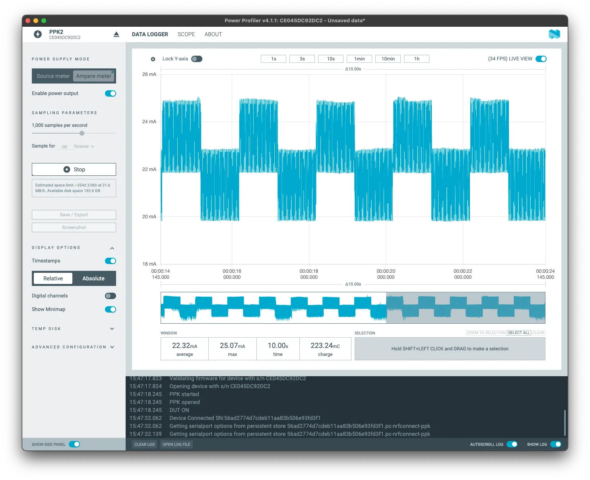
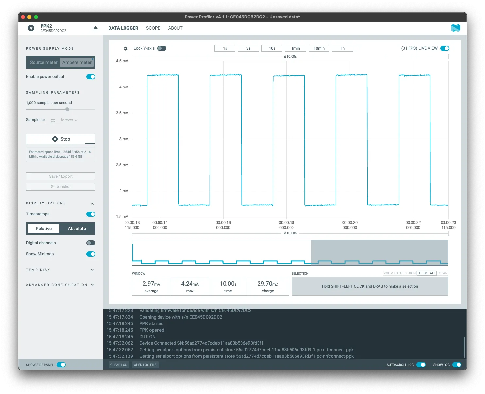

## Assignment 6: Low Power core

---

The ESP32-C5 features two cores: a high-power (HP) core for standard use (networking, complex computations) and a low-power (LP) RISC-V core designed to minimize energy consumption.

The LP core (often called the **ULP - Ultra Low Power core**) is designed to handle simple tasks while the main HP core is in deep sleep mode. This significantly reduces battery consumption, making it perfect for battery-powered projects. The LP core can collect data from sensors, control GPIOs, or increment a counter, waking up the HP core only when a threshold is met.

> **Start a fresh project again** — the LP-core toolchain and deep-sleep flow don't share anything with the Wi-Fi/ESP-NOW code from before. But **keep the button from Assignment 4 wired up** (GPIO0, pull-down to GND, other leg to 3V3 — see [Assignment 4, step 3](../assignment-4/#3-connecting-a-button) if you need a reminder of the wiring). We're going to give it a second job here: waking the board up on demand, in addition to the LP core's own periodic wake-up.

### 1. The Sleep Cycle

In this assignment, we will configure the HP core to go into Deep Sleep. The LP core will continue to run, perform a basic task, and eventually wake the HP core back up — or you can just press the button yourself to wake it immediately.

To use the LP core, we need to create a special sub-folder in our project called `main/ulp` and write the code that will run on the LP core there.

### 2. Configuration via menuconfig

Run:
```bash
idf.py menuconfig
```

Navigate to:
- **Component config ---> Ultra Low Power (ULP) Co-processor**
  - **Enable Ultra Low Power (ULP) Coprocessor**: Select `LP-core`
  - Leave other settings as default.

Press `Q` to quit and `Y` to save.

### 3. Writing the LP Core Code

Create a file named `main/ulp/main.c`. This code runs *only* on the LP core!

```c
#include <stdint.h>
#include "ulp_lp_core.h"
#include "ulp_lp_core_utils.h"

// Variables shared between HP and LP core
volatile uint32_t counter = 0;

int main(void)
{
    // Increment our counter
    counter++;

    // Wake the main CPU once the counter reaches 5
    if (counter >= 5) {
        ulp_lp_core_wakeup_main_processor();
        counter = 0;
    }

    // Go back to sleep until the LP timer wakes us again
    ulp_lp_core_halt();
    return 0;
}
```

### 4. Writing the HP Core Code (app_main)

In the C file under `main/` (`idf.py create-project` names it after the project, not `main.c`), initialize the LP core, arm the button as an extra wake-up source, and then put the HP core to sleep. Let's build it up piece by piece.

#### 4.1 Skeleton

```c
#include <stdio.h>
#include "freertos/FreeRTOS.h"
#include "esp_log.h"
#include "esp_sleep.h"
#include "ulp_lp_core.h"
#include "driver/gpio.h"

#define BUTTON_GPIO GPIO_NUM_0

extern const uint8_t ulp_main_bin_start[] asm("_binary_ulp_main_bin_start");
extern const uint8_t ulp_main_bin_end[]   asm("_binary_ulp_main_bin_end");

// This variable is mapped to the one in the LP core code!
extern uint32_t ulp_counter;

static const char *TAG = "lp_core";

// (A) Button setup, so it survives into deep sleep as a wake-up source
// (B) Figure out why we woke up (first boot? LP core? the button?)
// (C) On first boot only: load and start the LP core program
// (D) Arm both wake-up sources and go to sleep
void app_main(void)
{
    // ...
}
```

#### 4.2 Part (A): arming the button as a wake-up source

```c
static void configure_button_wakeup(void)
{
    gpio_config_t io_conf = {
        .pin_bit_mask = 1ULL << BUTTON_GPIO,
        .mode = GPIO_MODE_INPUT,
        .pull_up_en = GPIO_PULLUP_DISABLE,
        .pull_down_en = GPIO_PULLDOWN_DISABLE, // external pull-down resistor, same as Assignment 4
    };
    ESP_ERROR_CHECK(gpio_config(&io_conf));

    // Wake up as soon as the button pulls GPIO0 high, even while deep asleep
    ESP_ERROR_CHECK(esp_deep_sleep_enable_gpio_wakeup(1ULL << BUTTON_GPIO, ESP_GPIO_WAKEUP_GPIO_HIGH));
}
```

Unlike a regular `gpio_config`, deep sleep wake-up sources need to be explicitly re-armed with `esp_deep_sleep_enable_gpio_wakeup` on every boot, since the chip forgets about them once it wakes up.

#### 4.3 Parts (B)-(D): `app_main`

```c
void app_main(void)
{
    configure_button_wakeup();

    esp_sleep_wakeup_cause_t cause = esp_sleep_get_wakeup_cause();

    if (cause == ESP_SLEEP_WAKEUP_ULP) {
        ESP_LOGI(TAG, "Woken up by the LP core! LP Counter: %lu", ulp_counter);
    } else if (cause == ESP_SLEEP_WAKEUP_GPIO) {
        ESP_LOGI(TAG, "Woken up by the button!");
    } else {
        ESP_LOGI(TAG, "Regular boot. Starting LP core...");

        // Load the LP core binary
        ESP_ERROR_CHECK(ulp_lp_core_load_binary(ulp_main_bin_start,
                                                (ulp_main_bin_end - ulp_main_bin_start)));

        // Configure the LP core to wake up every 1 second
        ulp_lp_core_cfg_t cfg = {
            .wakeup_source = ULP_LP_CORE_WAKEUP_SOURCE_LP_TIMER,
            .lp_timer_sleep_duration_us = 1000000,
        };
        ESP_ERROR_CHECK(ulp_lp_core_run(&cfg));
    }

    ESP_LOGI(TAG, "HP Core going to deep sleep. The LP core will wake us up after 5 counts, or press the button to wake up right away.");

    // Allow the LP core to wake the main processor too
    ESP_ERROR_CHECK(esp_sleep_enable_ulp_wakeup());

    // Go to deep sleep
    esp_deep_sleep_start();
}
```

The LP core keeps counting and waking us up on its own schedule either way — the button is just an extra, immediate way to wake up without waiting for it, which is handy whenever you're debugging and don't want to sit around for the LP core's timer.

### 5. CMake Configuration

The build system needs to know about the LP core code. Open `main/CMakeLists.txt` and add the following lines at the end:

```cmake
ulp_embed_binary(ulp_main "ulp/main.c")
```

### 6. Build, Flash, and Monitor

```bash
idf.py build flash monitor
```

You should see the HP core boot, start the LP core, and go to sleep. After 5 seconds, the LP core will wake the HP core back up, and you'll see the message: `Woken up by the LP core!`. Press the button any time while the board is asleep, and you'll see `Woken up by the button!` instead — right away, without waiting for the counter.

The full project (including `main/ulp/main.c` and the `CMakeLists.txt` changes) is available at [`examples/C5/assignment-06-low-power`](../../../examples/C5/assignment-06-low-power/).

### Bonus: measuring the power savings

Why go through all this trouble instead of just blinking an LED from a FreeRTOS task on the HP core? Power consumption. We measured both approaches on the same board using a [PPK2](https://www.nordicsemi.com/Products/Development-hardware/Power-Profiler-Kit-2) power profiler hooked up to the devkit's `J5` current-measurement connector:

**Blinking from the HP core** (a busy task that never sleeps) averages about **22.32 mA**:



**Handing the same job to the LP core** (while the HP core deep-sleeps) drops that to about **2.97 mA**:



That's roughly **86.7% less current draw** for the exact same periodic task — the kind of difference that turns a battery lasting a day into one lasting a week.

## Conclusion

Congratulations! You have completed the ESP32-C5 workshop. You've learned how to connect to Wi-Fi, perform OTA updates, use ESP-NOW for peer-to-peer communication, and utilize the LP core to save battery life.

Thank you for participating!
