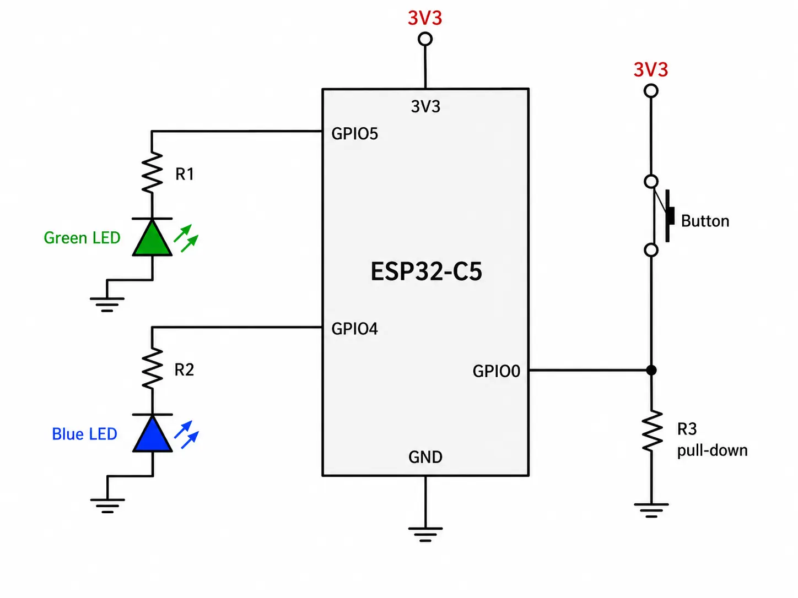

## Assignment 6: Low Power core

---

The ESP32-C5 has two cores: a high-power (HP) core for ordinary use, and a low-power (LP) core to keep consumption down.

The second core is usually called the **Ultra-Low-Power (ULP) core**. It is meant to handle simple tasks while the main (HP) core is asleep, which cuts power draw sharply. That matters for battery-powered projects, where efficiency counts for more than raw performance.

The ULP core can run on its own: collect sensor data and do basic processing, or drive GPIOs, all at very low power and a 20 MHz clock, comparable to an Arduino UNO. For the full picture of what this core can do, see
[ULP LP-Core Coprocessor Programming](https://docs.espressif.com/projects/esp-idf/en/latest/esp32c5/api-reference/system/ulp-lp-core.html#).

### The (U)LP core

- 32-bit RISC-V core at 40 MHz (up to 48 MHz depending on the crystal)
- 16 KB LP SRAM
- RISC-V IMAC instruction set (**I**nteger, **M**ultiplication/Division, **A**tomic, **C**ompressed)
- Runs as a coprocessor
- Can reach a subset of the peripherals
  - LP IO (LPGPIO0–LPGPIO6)
  - UART
  - I2C

The DevCon23 talk "Low-Power Features of ESP32-C6: Target Wake Time + LP Core" covers some of the LP core and TWT:

[Watch on YouTube](https://www.youtube.com/watch?v=FpTwQlGtV0k)

#### ULP pinout

The ULP core uses its own set of pins. Use the [board pinout](../introduction/#board-pin-layout) when you need to see which pins the LP core can drive.

### Hands-on with the LP core

In this exercise we blink an LED twice: once from the "big" HP core, and once from the ULP core, and compare the power draw.

> **Note:** **Create a new project for this assignment.**

```bash
idf.py create-project lp_core
cd lp_core
idf.py set-target esp32c5
```

> `idf.py create-project` names the source file after the project, so the HP core code belongs in `main/lp_core.c`. The LP core code goes in `main/ulp/main.c`. The project also contains several `CMakeLists.txt` files — edit the one in the `main/` folder.

1. **Create a `main/ulp` folder and a `main.c` file inside it**

```c
#include <stdint.h>
#include <stdbool.h>
#include "ulp_lp_core.h"
#include "ulp_lp_core_utils.h"
#include "ulp_lp_core_gpio.h"
#include "ulp_lp_core_interrupts.h"

#define WAKEUP_PIN LP_IO_NUM_0
#define BLUE_PIN    LP_IO_NUM_4
#define GREEN_PIN  LP_IO_NUM_5

static uint32_t wakeup_count;
uint32_t start_toggle;

void LP_CORE_ISR_ATTR ulp_lp_core_lp_io_intr_handler(void)
{
    ulp_lp_core_gpio_clear_intr_status();
    wakeup_count++;
}

int main (void)
{
    /* Register interrupt for the wakeup pin */
    ulp_lp_core_intr_enable();
    ulp_lp_core_gpio_intr_enable(WAKEUP_PIN, LP_IO_INTR_POSEDGE);

    int level = 0;
    while (1) {
        /* Toggle the Red LED GPIO */
        ulp_lp_core_gpio_set_level(GREEN_PIN, 0);
        ulp_lp_core_gpio_set_level(BLUE_PIN, level);
        level = level ? 0 : 1;
        ulp_lp_core_delay_us(1000000);

        /* Wakeup the main processor after 4 toggles of the button */
        if (wakeup_count >= 4) {
            ulp_lp_core_gpio_set_level(BLUE_PIN, 0);
            ulp_lp_core_wakeup_main_processor();
            wakeup_count = 0;
        }
    }
    /* ulp_lp_core_halt() is called automatically when main exits */
    return 0;
}
```

This code enables interrupts on the LP core with `ulp_lp_core_intr_enable`, and sets `GPIO0` as an input that fires on a rising edge (the signal going from LOW to HIGH). `ulp_lp_core_gpio_intr_enable` connects that pin to the interrupt. The wake-up counter is handled by the interrupt handler `ulp_lp_core_lp_io_intr_handler`.

A loop then blinks the LED and checks the wake-up counter. `ulp_lp_core_gpio_set_level` drives the GPIO. Once the button has been pressed 4 times or more, `ulp_lp_core_wakeup_main_processor` starts the HP core.

2. **Changes in `main/CMakeLists.txt`**

CMake needs the ULP application name, its source files, and a few related settings:

```text
# Set usual component variables
set(app_sources "lp_core.c")
idf_component_register(SRCS ${app_sources}
                       REQUIRES ulp
                       WHOLE_ARCHIVE)
#
# ULP support additions to component CMakeLists.txt.
#
# 1. The ULP app name must be unique (if multiple components use ULP).
set(ulp_app_name ulp_${COMPONENT_NAME})
#
# 2. Specify all C and Assembly source files.
#    Files should be placed into a separate directory (in this case, ulp/),
#    which should not be added to COMPONENT_SRCS.
set(ulp_sources "ulp/main.c")
#
# 3. List all the component source files which include automatically
#    generated ULP export file, ${ulp_app_name}.h:
set(ulp_exp_dep_srcs ${app_sources})
#
# 4. Call function to build ULP binary and embed in project using the argument
#    values above.
ulp_embed_binary(${ulp_app_name} "${ulp_sources}" "${ulp_exp_dep_srcs}")

```

3. **HP core code in `main/lp_core.c`**

```c
#include <stdio.h>
#include "esp_sleep.h"
#include "driver/gpio.h"
#include "driver/rtc_io.h"
#include "ulp_lp_core.h"
#include "ulp_main.h"
#include "freertos/FreeRTOS.h"
#include "freertos/task.h"

extern const uint8_t ulp_main_bin_start[] asm("_binary_ulp_main_bin_start");
extern const uint8_t ulp_main_bin_end[]   asm("_binary_ulp_main_bin_end");

static void init_ulp_program(void);

#define WAKEUP_PIN  GPIO_NUM_0
#define BLUE_PIN    GPIO_NUM_4
#define GREEN_PIN   GPIO_NUM_5

void app_main(void)
{
    vTaskDelay(pdMS_TO_TICKS(1000));

    esp_sleep_wakeup_cause_t cause = esp_sleep_get_wakeup_cause();
    if (cause == ESP_SLEEP_WAKEUP_ULP) {
        printf("ULP woke up the main CPU! \n");
        ulp_lp_core_stop();
    }

    printf("In active mode\n");
    printf("Long press the wake button to put the chip to sleep and run the ULP\n");

    rtc_gpio_init(WAKEUP_PIN);
    rtc_gpio_set_direction(WAKEUP_PIN, RTC_GPIO_MODE_INPUT_ONLY);
    rtc_gpio_pulldown_dis(WAKEUP_PIN);
    rtc_gpio_pullup_dis(WAKEUP_PIN);

    rtc_gpio_init(BLUE_PIN);
    rtc_gpio_set_direction(BLUE_PIN, RTC_GPIO_MODE_OUTPUT_ONLY);
    rtc_gpio_pulldown_dis(BLUE_PIN);
    rtc_gpio_pullup_dis(BLUE_PIN);

    rtc_gpio_init(GREEN_PIN);
    rtc_gpio_set_direction(GREEN_PIN, RTC_GPIO_MODE_OUTPUT_ONLY);
    rtc_gpio_pulldown_dis(GREEN_PIN);
    rtc_gpio_pullup_dis(GREEN_PIN);

    int gpio_level = 0;
    int previous_gpio_level = 0;
    int cnt = 0;

    while (1) {
        rtc_gpio_set_level(BLUE_PIN, 0);
        rtc_gpio_set_level(GREEN_PIN, 1);
        vTaskDelay(pdMS_TO_TICKS(1000));
        rtc_gpio_set_level(GREEN_PIN, 0);
        vTaskDelay(pdMS_TO_TICKS(1000));

        gpio_level = rtc_gpio_get_level(WAKEUP_PIN);
        if (gpio_level != previous_gpio_level) {
            previous_gpio_level = gpio_level;
            cnt++;
            if (cnt > 1) {
                rtc_gpio_set_level(GREEN_PIN, 0);
                cnt = 0;
                break;
            }
        }
    }

    init_ulp_program();

    printf("Entering Deep-sleep mode\n\n");
    printf("Press the wake button at least 3 or 4 times to wake up the main CPU again\n");
    vTaskDelay(10);

    ESP_ERROR_CHECK( esp_sleep_enable_ulp_wakeup());

    esp_deep_sleep_start();
}

static void init_ulp_program(void)
{
    esp_err_t err = ulp_lp_core_load_binary(ulp_main_bin_start,
                        (ulp_main_bin_end - ulp_main_bin_start));
    ESP_ERROR_CHECK(err);

    ulp_lp_core_cfg_t cfg = {
        .wakeup_source = ULP_LP_CORE_WAKEUP_SOURCE_HP_CPU,
    };

    err = ulp_lp_core_run(&cfg);
    ESP_ERROR_CHECK(err);
}
```

The same program is in [`examples/C5/assignment-06-low-power`](../../../examples/C5/assignment-06-low-power/), as `main/lp_core.c` and `main/ulp/main.c`, with the matching `CMakeLists.txt` and `sdkconfig.defaults`.

4. **Enable the LP core in the configuration**

The LP core has to be switched on before the project can build code for it. One way is to create `sdkconfig.defaults` with:

```text
# Enable ULP
CONFIG_ULP_COPROC_ENABLED=y
CONFIG_ULP_COPROC_TYPE_LP_CORE=y
CONFIG_ULP_COPROC_RESERVE_MEM=4096
# Set log level to Warning to produce clean output
CONFIG_BOOTLOADER_LOG_LEVEL_WARN=y
CONFIG_BOOTLOADER_LOG_LEVEL=2
CONFIG_LOG_DEFAULT_LEVEL_WARN=y
CONFIG_LOG_DEFAULT_LEVEL=2
```

5. **Hardware setup**

This example needs two extra LEDs and one button, on these pins:

- Blue LED -> **GPIO4**
- Green LED -> **GPIO5**
- Button (pull-down, active high) -> **GPIO0**. One side of the button goes to **3.3 V**, the other to **GPIO0**. Also put a resistor between **GPIO0** and **GND**.


*Button wiring*



*Complete diagram showing how to connect both LEDs (GPIO4, GPIO5) and the button (GPIO0) to the ESP32-C5-DevKitC-1.*

6. **Build, flash, and monitor**

Use the USB port labeled **UART** for flashing and for the monitor. Erasing flash (*Erase Flash*) before you flash this example is safe.

#### What should happen...

After flashing, the green LED should blink once a second, with this output:

```text
In active mode
Long press the wake button to put the chip to sleep and run the ULP
```

A long press on the button starts the LP core and puts the HP core into deep sleep. The blue LED then blinks once a second, with this output:

```text
Entering Deep-sleep mode
Press the wake button at least 3 or 4 times to wake up the main CPU again
```

Four clicks of the button wake the chip from deep sleep:

```text
ULP woke up the main CPU!
In active mode
Long press the wake button to put the chip to sleep and run the ULP
```

Power is measured on the J5 header with a suitable tool, for example a [JouleScope](https://www.joulescope.com/) or a [PPK2](https://www.nordicsemi.com/Products/Development-hardware/Power-Profiler-Kit-2).

**Blinking the LED from the HP core**

With the "big" HP core doing the work, average consumption over 10 seconds is about **22.32 mA**.


**Blinking the LED from the LP core**

Moving the same job to the LP core drops that by about an order of magnitude, to **2.97 mA**.


Switching cores saves up to **86.7%** for the same task. Treat the numbers as a guide; real results will differ.

More LP core examples:

- [LP Core simple example with GPIO Polling](https://github.com/espressif/esp-idf/tree/master/examples/system/ulp/lp_core/gpio)
- [LP Core Pulse Counting Example](https://github.com/espressif/esp-idf/tree/master/examples/system/ulp/lp_core/gpio_intr_pulse_counter)
- [LP-Core example with interrupt triggered from HP-Core](https://github.com/espressif/esp-idf/tree/master/examples/system/ulp/lp_core/interrupt)
- [LP I2C Example](https://github.com/espressif/esp-idf/tree/master/examples/system/ulp/lp_core/lp_i2c)
- [LP UART Examples](https://github.com/espressif/esp-idf/tree/master/examples/system/ulp/lp_core/lp_uart)

## Conclusion

Thank you for taking part in the workshop. We hope it was useful.

Along the way we covered:

- **Assignment 1**: Installed ESP-IDF and learned the basics of using it.
- **Assignment 2**: Created a project, learned what components are, and used one to light the onboard LED.
- **Assignment 3**: Connected to Wi-Fi with BLE provisioning.
- **Assignment 4**: Tried an OTA update and the partition table.
- **Assignment 5**: Built an ESP-NOW chat room.
- **Assignment 6**: Ran code on the LP core and learned how to control power consumption.

That is still only a skim of the surface. Both the ESP32 and ESP-IDF offer much more. We hope the workshop gave you a solid base to keep building your own projects on.

Thank you again, and we look forward to your projects.

---

[← Back to the C5 workshop home](../)
