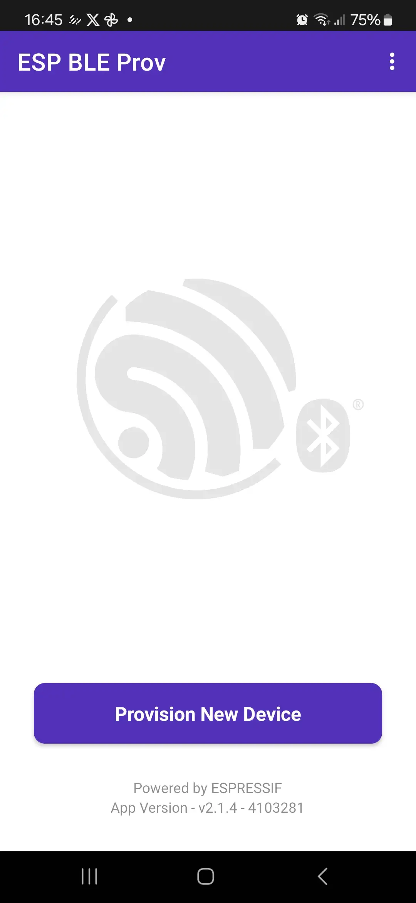
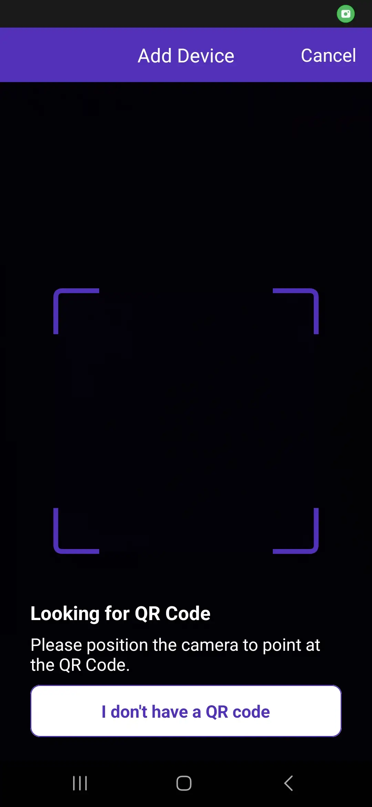
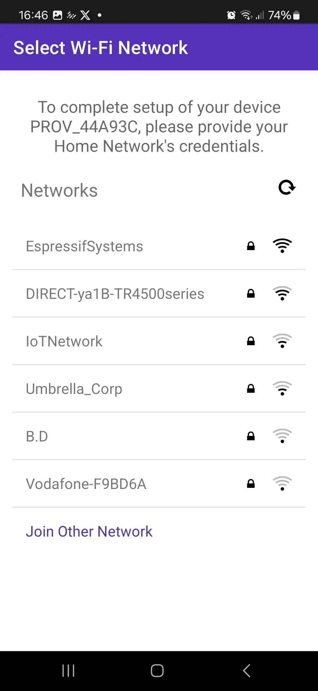
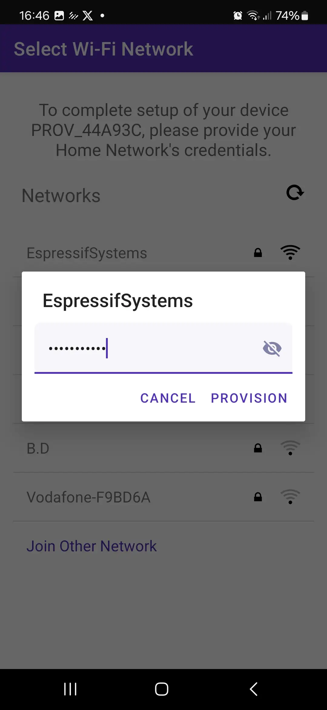
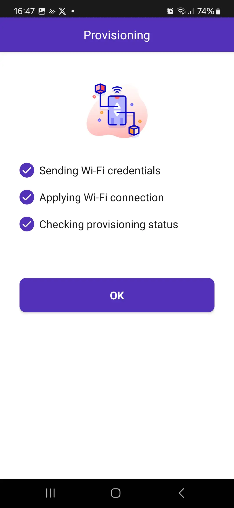

## Úkol 3: Wi-Fi a provisioning

---

Wi-Fi je jednou z nejdůležitějších vlastností IoT zařízení. **ESP32-C6** je výjimečné tím, že je prvním SoC od Espressifu s podporou **Wi-Fi 6** (802.11ax) v pásmu 2.4 GHz. Wi-Fi 6 přináší například Target Wake Time (TWT), díky kterému se zařízení napájené z baterie může s routerem domluvit, kdy se probudí, a lepší chování v přeplněných sítích.

V reálném produktu nemůžete přihlašovací údaje k Wi-Fi (SSID a heslo) zadrátovat přímo do zdrojového kódu, protože každý uživatel má jinou domácí síť. Místo toho se používá **Wi-Fi provisioning**. Provisioning umožňuje uživateli poslat do zařízení přihlašovací údaje k Wi-Fi pomocí mobilní aplikace přes sekundární kanál, typicky Bluetooth Low Energy (BLE).

V tomto úkolu použijeme k provisioningu naší desky mobilní aplikaci **ESP BLE Prov**. Každá deska vypíše v terminálu **QR kód**; jeho naskenováním aplikace zjistí, ke kterému zařízení se má připojit (každá deska má unikátní jméno), i tajný klíč potřebný pro komunikaci s ním, takže nemusíte nic vypisovat ani vybírat ze seznamu desítek zařízení. Přihlašovací údaje se uloží do NVS (Non-Volatile Storage), takže se deska po restartu automaticky znovu připojí.

> **Použijte projekt z Úkolu 2.** Otevřete stejnou složku `my_first_project`, kterou jste vytvořili v Úkolu 2, a nevytvářejte nový projekt. *Obsah* souboru `main/my_first_project.c` kompletně nahradíme logikou pro Wi-Fi a provisioning uvedenou níže. Kód pro LED z Úkolu 2 v tomto úkolu nepotřebujeme (nevadí, když ho z `main/my_first_project.c` smažete, závislost `led_strip` může v `idf_component.yml` klidně zůstat nepoužitá), LED vrátíme do hry až v Úkolu 5.

### 1. Zapnutí potřebných komponent

Budeme potřebovat komponentu `wifi_provisioning`. Protože je součástí ESP-IDF, stačí jen zajistit, že náš kód includuje správné hlavičkové soubory a správně inicializuje NVS.

Abychom mohli QR kód zobrazit v terminálu, přidáme ještě komponentu `espressif/qrcode` z component registry (stejně jako jsme v Úkolu 2 přidali `led_strip`):

```bash
idf.py add-dependency "espressif/qrcode^0.1.0"
idf.py reconfigure
```

### 2. Konfigurace pomocí menuconfig

BLE transport, který se chystáme použít (`wifi_prov_scheme_ble`), se do `wifi_provisioning` zkompiluje pouze tehdy, je-li zapnutý samotný Bluetooth, což ve výchozím stavu není. Spusťte:

```bash
idf.py menuconfig
```

Přejděte do:
- **Component config ---> Bluetooth**
  - **Bluetooth**: zapněte.
  - **Host**: vyberte `NimBLE`. ESP32-C6 má pouze BLE rádio a NimBLE je odlehčený host pouze pro BLE (těžší stack Bluedroid zde nepotřebujeme).
- **Partition Table**
  - **Partition Table**: vyberte `Single factory app (large), no OTA`. Kód NimBLE a provisioningu se už nevejde do výchozí 1MB aplikační partition.

Stiskněte `Q` pro ukončení a `Y` pro uložení.

> Nechcete klikat v menuconfigu? Vložte místo toho následující řádky do souboru `sdkconfig.defaults` v kořenovém adresáři projektu a znovu spusťte `idf.py set-target esp32c6`, aby se načetly:
> ```text
> CONFIG_BT_ENABLED=y
> CONFIG_BT_NIMBLE_ENABLED=y
> CONFIG_PARTITION_TABLE_SINGLE_APP_LARGE=y
> ```

### 3. Psaní kódu

Soubor `main/my_first_project.c` opět postavíme po částech, místo abychom na vás celý kód vysypali najednou.

#### 3.1 Kostra

```c
#include <stdio.h>
#include <string.h>
#include "freertos/FreeRTOS.h"
#include "freertos/task.h"
#include "freertos/event_groups.h"
#include "esp_log.h"
#include "esp_wifi.h"
#include "esp_event.h"
#include "esp_mac.h"
#include "esp_timer.h"
#include "nvs_flash.h"
#include "qrcode.h"
#include "wifi_provisioning/manager.h"
#include "wifi_provisioning/scheme_ble.h"

static const char *TAG = "provisioning";

// Proof-of-possession: the app gets it from the QR code, so the user never types it
#define PROV_POP "abcd1234"

// True, dokud běží provisioning manager. Připojuje se sám přes esp_wifi_connect(), takže mu nesmíme překážet.
static volatile bool s_prov_active = false;

// Prodlevy při opětovném připojení: 1 s, 2 s, 4 s ... až 30 s mezi pokusy, abychom nedosažitelný router neutloukli.
#define RECONNECT_MAX_DELAY_MS 30000
static int s_retry_count = 0;
static esp_timer_handle_t s_reconnect_timer;

static void reconnect_cb(void *arg)
{
    esp_wifi_connect();
}

// (A) One handler for every Wi-Fi / provisioning event we care about
static void event_handler(void* arg, esp_event_base_t event_base, int32_t event_id, void* event_data)
{
    // ...
}

void app_main(void)
{
    // (B) NVS must work before Wi-Fi or provisioning can store anything
    // (C) Bring up the networking stack
    // (D) Hook our event_handler into the events we need
    // (E) Start (or skip) provisioning, depending on whether we did it before
}
```

#### 3.2 Část (A): event handler

Provisioning i Wi-Fi hlásí, co se děje, přes systém událostí ESP-IDF (*events*), a ne přes návratové hodnoty. Díky tomu můžeme reagovat na věci jako „přišly přihlašovací údaje“ nebo „spojení bylo ztraceno“ kdykoli nastanou, a ne jen těsně po zavolání nějaké funkce.

```c
static void event_handler(void* arg, esp_event_base_t event_base, int32_t event_id, void* event_data)
{
    if (event_base == WIFI_PROV_EVENT) {
        switch (event_id) {
            case WIFI_PROV_START:
                ESP_LOGI(TAG, "Provisioning started");
                break;
            case WIFI_PROV_CRED_RECV: {
                /* event_data nese SSID a heslo, které telefon právě poslal. */
                wifi_sta_config_t *wifi_sta_cfg = (wifi_sta_config_t *)event_data;
                /* POUZE UKÁZKA: v produkci nikdy neloguj hesla. Tady se vypisuje, abyste viděli, co telefon poslal. */
                ESP_LOGI(TAG, "Received Wi-Fi credentials\n\tSSID     : %s\n\tPassword : %s (do not log passwords in plaintext ;))",
                         (const char *) wifi_sta_cfg->ssid,
                         (const char *) wifi_sta_cfg->password);
                break;
            }
            case WIFI_PROV_CRED_FAIL:
                /* Špatné heslo nebo AP nenalezeno. Zapomeň špatné údaje, jinak by se deska po restartu
                   tvářila jako „už provisioned“ a provisioning už nikdy nenabídla. */
                ESP_LOGE(TAG, "Provisioning failed. Check the password and try again.");
                wifi_prov_mgr_reset_sm_state_on_failure();
                break;
            case WIFI_PROV_CRED_SUCCESS:
                ESP_LOGI(TAG, "Provisioning successful");
                break;
            case WIFI_PROV_END:
                ESP_LOGI(TAG, "Provisioning completed. Deinitializing manager.");
                s_prov_active = false;
                wifi_prov_mgr_deinit(); /* manager dosloužil; uvolnit ho */
                break;
            default:
                break;
        }
    } else if (event_base == WIFI_EVENT && event_id == WIFI_EVENT_STA_START) {
        /* Rádio běží; začít se připojovat (během provisioningu to dělá manager). */
        if (!s_prov_active) {
            esp_wifi_connect();
        }
    } else if (event_base == IP_EVENT && event_id == IP_EVENT_STA_GOT_IP) {
        /* event_data nese adresu, kterou přidělilo DHCP. */
        ip_event_got_ip_t* event = (ip_event_got_ip_t*) event_data;
        ESP_LOGI(TAG, "Connected with IP Address:" IPSTR, IP2STR(&event->ip_info.ip));
        s_retry_count = 0; /* připojeno; další výpadek začne zase krátkou prodlevou */
    } else if (event_base == WIFI_EVENT && event_id == WIFI_EVENT_STA_DISCONNECTED) {
        if (!s_prov_active) {
            /* spojení padlo; zkusit znovu, po každém neúspěchu s delší prodlevou */
            uint32_t delay_ms = 1000U << (s_retry_count < 5 ? s_retry_count : 5);
            if (delay_ms > RECONNECT_MAX_DELAY_MS) {
                delay_ms = RECONNECT_MAX_DELAY_MS;
            }
            s_retry_count++;
            ESP_LOGI(TAG, "Disconnected. Connecting to the AP again in %lu ms...", (unsigned long)delay_ms);
            esp_timer_start_once(s_reconnect_timer, (uint64_t)delay_ms * 1000);
        }
    }
}
```

Obsluhujeme tyto situace: provisioning začal, přišly přihlašovací údaje (abychom mohli vypsat, co jsme dostali), provisioning selhal, provisioning skončil (takže můžeme provisioning manager vypnout, už ho nepotřebujeme) a běžné připojení, odpojení a opětovné připojení k Wi-Fi.

Tři věci stojí za pozornost:

- **Heslo logujeme jen kvůli ukázce.** V reálném produktu nikdy nevypisujte hesla v čitelné podobě.
- **Opětovná připojení mají prodlevy.** Když je router nedostupný, deska čeká mezi pokusy 1 s, 2 s, 4 s ... až 30 s (pomocí jednorázového `esp_timer`, takže se nikdy neblokuje smyčka událostí) místo toho, aby se pokoušela dokola bez přestávky. Úspěšné připojení prodlevu vynuluje.
- **`WIFI_PROV_CRED_FAIL` je nutné obsloužit.** Když uživatel překlepne heslo, přihlašovací údaje jsou už uložené v NVS. Bez `wifi_prov_mgr_reset_sm_state_on_failure()` by se deska po restartu tvářila jako „už provisioned“, donekonečna by zkoušela špatnou síť a provisioning už by nikdy nenabídla. Dokud je nastavený příznak `s_prov_active`, také nevoláme vlastní `esp_wifi_connect()`, protože provisioning manager se připojuje sám a obě volání by se srážela.

#### 3.3 Části (B)-(C): NVS a síť

```c
void app_main(void)
{
    // (B) Initialize NVS (needed for Wi-Fi and Provisioning to save data)
    esp_err_t ret = nvs_flash_init();
    /* Flash se mazala nebo se změnil layout; začít s čistou NVS. */
    if (ret == ESP_ERR_NVS_NO_FREE_PAGES || ret == ESP_ERR_NVS_NEW_VERSION_FOUND) {
        ESP_ERROR_CHECK(nvs_flash_erase());
        ret = nvs_flash_init();
    }
    ESP_ERROR_CHECK(ret);

    // (C) Initialize networking
    ESP_ERROR_CHECK(esp_netif_init()); /* TCP/IP stack */
    ESP_ERROR_CHECK(esp_event_loop_create_default()); /* smyčka, do které Wi-Fi posílá události */
    esp_netif_create_default_wifi_sta(); /* výchozí station rozhraní, zatím bez IP */
    wifi_init_config_t cfg = WIFI_INIT_CONFIG_DEFAULT();
    ESP_ERROR_CHECK(esp_wifi_init(&cfg));
```

NVS musí být inicializované jako první, protože se na něj spoléhá jak Wi-Fi (kalibrační data), tak provisioning manager (uložené přihlašovací údaje).

#### 3.4 Části (D)-(E): zapojení událostí a spuštění provisioningu

```c
    // (D) Register event handlers
    const esp_timer_create_args_t reconnect_args = { .callback = &reconnect_cb, .name = "wifi_reconnect" };
    ESP_ERROR_CHECK(esp_timer_create(&reconnect_args, &s_reconnect_timer)); /* používá se pro prodlevy při opětovném připojení */
    ESP_ERROR_CHECK(esp_event_handler_register(WIFI_PROV_EVENT, ESP_EVENT_ANY_ID, &event_handler, NULL));
    ESP_ERROR_CHECK(esp_event_handler_register(WIFI_EVENT, ESP_EVENT_ANY_ID, &event_handler, NULL));
    ESP_ERROR_CHECK(esp_event_handler_register(IP_EVENT, IP_EVENT_STA_GOT_IP, &event_handler, NULL)); /* jen událost o získání adresy */

    // (E) Start Wi-Fi Provisioning Manager
    wifi_prov_mgr_config_t config = {
        .scheme = wifi_prov_scheme_ble, /* s telefonem mluvíme přes BLE */
        .scheme_event_handler = WIFI_PROV_SCHEME_BLE_EVENT_HANDLER_FREE_BTDM /* po skončení uvolní BLE paměť */
    };
    ESP_ERROR_CHECK(wifi_prov_mgr_init(config));

    bool provisioned = false;
    /* Koukne do NVS: už jsme někdy dostali přihlašovací údaje? */
    ESP_ERROR_CHECK(wifi_prov_mgr_is_provisioned(&provisioned));

    if (!provisioned) {
        ESP_LOGI(TAG, "Starting provisioning");
        // Unique name per board (last 3 bytes of the MAC), so many boards can be provisioned in one room
        uint8_t mac[6];
        ESP_ERROR_CHECK(esp_read_mac(mac, ESP_MAC_WIFI_STA));
        char service_name[16];
        snprintf(service_name, sizeof(service_name), "PROV_%02X%02X%02X", mac[3], mac[4], mac[5]);

        s_prov_active = true;
        // Security 1: encrypted session, authenticated by the proof-of-possession from the QR code
        ESP_ERROR_CHECK(wifi_prov_mgr_start_provisioning(WIFI_PROV_SECURITY_1, PROV_POP, service_name, NULL));
        print_qr(service_name);
    } else {
        ESP_LOGI(TAG, "Already provisioned, starting Wi-Fi");
        wifi_prov_mgr_deinit(); /* nikdy neběžel; jen zahodit manager */
        ESP_ERROR_CHECK(esp_wifi_set_mode(WIFI_MODE_STA));
        ESP_ERROR_CHECK(esp_wifi_start());
    }
}
```

Používáme **security 1**: spojení mezi telefonem a deskou je šifrované a telefon musí prokázat, že zná *proof-of-possession* (`PROV_POP`). Přesně to očekává aplikace ESP BLE Prov, když pracuje s QR kódem, proto security 0 končilo chybou „security does not match“.

> **Zkratka pro workshop: jedno PoP pro všechny desky.** Všechny desky tady sdílejí stejný proof-of-possession, `abcd1234`, který je napsaný přímo v tomto textu. Pro místnost plnou účastníků workshopu je to v pořádku, pro produkt ne: kdokoli v dosahu Bluetooth, kdo PoP zná, by mohl novému zařízení nastavit vlastní přihlašovací údaje k Wi-Fi. Skutečný produkt dává každému zařízení vlastní PoP, buď odvozené z něčeho jedinečného pro desku (například část MAC adresy), nebo lépe náhodnou hodnotu vygenerovanou při prvním startu a zobrazenou jen v QR kódu nebo na štítku zařízení. Kód zůstává stejný: mění se jen řetězec předaný funkci `wifi_prov_mgr_start_provisioning()` a vložený do QR kódu.

QR kód je jen krátký JSON text se jménem zařízení, PoP a transportem (`ble`). Jeho generování a vykreslení pro nás není zajímavé, takže tady je pomocná funkce, kterou vložte do `main/my_first_project.c` nad `app_main`:

```c
static void print_qr(const char *service_name)
{
    char payload[150];
    snprintf(payload, sizeof(payload),
             "{\"ver\":\"v1\",\"name\":\"%s\",\"pop\":\"%s\",\"transport\":\"ble\"}",
             service_name, PROV_POP);
    ESP_LOGI(TAG, "Scan this QR code with the ESP BLE Prov app:");
    esp_qrcode_config_t qr_cfg = ESP_QRCODE_CONFIG_DEFAULT();
    esp_qrcode_generate(&qr_cfg, payload); /* vykreslí QR kód do výstupu monitoru */
}
```

Příznak `provisioned` zajišťuje, že desku můžete flashovat opakovaně: manager zkontroluje, zda jsou v NVS uložené přihlašovací údaje, a pokud ano, provisioning úplně přeskočí a rovnou se připojí k Wi-Fi.

#### 3.5 Kompletní kód

Celý soubor (a odpovídající projekt, se kterým můžete svůj porovnat) najdete v [`examples/C6/assignment-03-wifi-provisioning`](../../examples/C6/assignment-03-wifi-provisioning/):

```c
#include <stdio.h>
#include <string.h>
#include "freertos/FreeRTOS.h"
#include "freertos/task.h"
#include "freertos/event_groups.h"
#include "esp_log.h"
#include "esp_wifi.h"
#include "esp_event.h"
#include "esp_mac.h"
#include "esp_timer.h"
#include "nvs_flash.h"
#include "qrcode.h"
#include "wifi_provisioning/manager.h"
#include "wifi_provisioning/scheme_ble.h"

static const char *TAG = "provisioning";

// Proof-of-possession: the app gets it from the QR code, so the user never types it
#define PROV_POP "abcd1234"

// True, dokud běží provisioning manager. Připojuje se sám přes esp_wifi_connect(), takže mu nesmíme překážet.
static volatile bool s_prov_active = false;

// Prodlevy při opětovném připojení: 1 s, 2 s, 4 s ... až 30 s mezi pokusy, abychom nedosažitelný router neutloukli.
#define RECONNECT_MAX_DELAY_MS 30000
static int s_retry_count = 0;
static esp_timer_handle_t s_reconnect_timer;

static void reconnect_cb(void *arg)
{
    esp_wifi_connect();
}

// Print the QR code the ESP BLE Prov app scans (device name, PoP and transport).
// How the QR code is rendered is not important for this workshop.
static void print_qr(const char *service_name)
{
    char payload[150];
    snprintf(payload, sizeof(payload),
             "{\"ver\":\"v1\",\"name\":\"%s\",\"pop\":\"%s\",\"transport\":\"ble\"}",
             service_name, PROV_POP);
    ESP_LOGI(TAG, "Scan this QR code with the ESP BLE Prov app:");
    esp_qrcode_config_t qr_cfg = ESP_QRCODE_CONFIG_DEFAULT();
    esp_qrcode_generate(&qr_cfg, payload); /* vykreslí QR kód do výstupu monitoru */
}

// Event handler for Wi-Fi events
static void event_handler(void* arg, esp_event_base_t event_base, int32_t event_id, void* event_data)
{
    if (event_base == WIFI_PROV_EVENT) {
        switch (event_id) {
            case WIFI_PROV_START:
                ESP_LOGI(TAG, "Provisioning started");
                break;
            case WIFI_PROV_CRED_RECV: {
                /* event_data nese SSID a heslo, které telefon právě poslal. */
                wifi_sta_config_t *wifi_sta_cfg = (wifi_sta_config_t *)event_data;
                /* POUZE UKÁZKA: v produkci nikdy neloguj hesla. Tady se vypisuje, abyste viděli, co telefon poslal. */
                ESP_LOGI(TAG, "Received Wi-Fi credentials\n\tSSID     : %s\n\tPassword : %s (do not log passwords in plaintext ;))",
                         (const char *) wifi_sta_cfg->ssid,
                         (const char *) wifi_sta_cfg->password);
                break;
            }
            case WIFI_PROV_CRED_FAIL:
                /* Špatné heslo nebo AP nenalezeno. Zapomeň špatné údaje, jinak by se deska po restartu
                   tvářila jako „už provisioned“ a provisioning už nikdy nenabídla. */
                ESP_LOGE(TAG, "Provisioning failed. Check the password and try again.");
                wifi_prov_mgr_reset_sm_state_on_failure();
                break;
            case WIFI_PROV_CRED_SUCCESS:
                ESP_LOGI(TAG, "Provisioning successful");
                break;
            case WIFI_PROV_END:
                ESP_LOGI(TAG, "Provisioning completed. Deinitializing manager.");
                s_prov_active = false;
                wifi_prov_mgr_deinit(); /* manager dosloužil; uvolnit ho */
                break;
            default:
                break;
        }
    } else if (event_base == WIFI_EVENT && event_id == WIFI_EVENT_STA_START) {
        /* Rádio běží; začít se připojovat (během provisioningu to dělá manager). */
        if (!s_prov_active) {
            esp_wifi_connect();
        }
    } else if (event_base == IP_EVENT && event_id == IP_EVENT_STA_GOT_IP) {
        /* event_data nese adresu, kterou přidělilo DHCP. */
        ip_event_got_ip_t* event = (ip_event_got_ip_t*) event_data;
        ESP_LOGI(TAG, "Connected with IP Address:" IPSTR, IP2STR(&event->ip_info.ip));
        s_retry_count = 0; /* připojeno; další výpadek začne zase krátkou prodlevou */
    } else if (event_base == WIFI_EVENT && event_id == WIFI_EVENT_STA_DISCONNECTED) {
        if (!s_prov_active) {
            /* spojení padlo; zkusit znovu, po každém neúspěchu s delší prodlevou */
            uint32_t delay_ms = 1000U << (s_retry_count < 5 ? s_retry_count : 5);
            if (delay_ms > RECONNECT_MAX_DELAY_MS) {
                delay_ms = RECONNECT_MAX_DELAY_MS;
            }
            s_retry_count++;
            ESP_LOGI(TAG, "Disconnected. Connecting to the AP again in %lu ms...", (unsigned long)delay_ms);
            esp_timer_start_once(s_reconnect_timer, (uint64_t)delay_ms * 1000);
        }
    }
}

void app_main(void)
{
    // 1. Initialize NVS (needed for Wi-Fi and Provisioning to save data)
    esp_err_t ret = nvs_flash_init();
    /* Flash se mazala nebo se změnil layout; začít s čistou NVS. */
    if (ret == ESP_ERR_NVS_NO_FREE_PAGES || ret == ESP_ERR_NVS_NEW_VERSION_FOUND) {
        ESP_ERROR_CHECK(nvs_flash_erase());
        ret = nvs_flash_init();
    }
    ESP_ERROR_CHECK(ret);

    // 2. Initialize networking
    ESP_ERROR_CHECK(esp_netif_init()); /* TCP/IP stack */
    ESP_ERROR_CHECK(esp_event_loop_create_default()); /* smyčka, do které Wi-Fi posílá události */
    esp_netif_create_default_wifi_sta(); /* výchozí station rozhraní, zatím bez IP */
    wifi_init_config_t cfg = WIFI_INIT_CONFIG_DEFAULT();
    ESP_ERROR_CHECK(esp_wifi_init(&cfg));

    // 3. Register event handlers
    const esp_timer_create_args_t reconnect_args = { .callback = &reconnect_cb, .name = "wifi_reconnect" };
    ESP_ERROR_CHECK(esp_timer_create(&reconnect_args, &s_reconnect_timer)); /* používá se pro prodlevy při opětovném připojení */
    ESP_ERROR_CHECK(esp_event_handler_register(WIFI_PROV_EVENT, ESP_EVENT_ANY_ID, &event_handler, NULL));
    ESP_ERROR_CHECK(esp_event_handler_register(WIFI_EVENT, ESP_EVENT_ANY_ID, &event_handler, NULL));
    ESP_ERROR_CHECK(esp_event_handler_register(IP_EVENT, IP_EVENT_STA_GOT_IP, &event_handler, NULL)); /* jen událost o získání adresy */

    // 4. Start Wi-Fi Provisioning Manager
    wifi_prov_mgr_config_t config = {
        .scheme = wifi_prov_scheme_ble, /* s telefonem mluvíme přes BLE */
        .scheme_event_handler = WIFI_PROV_SCHEME_BLE_EVENT_HANDLER_FREE_BTDM /* po skončení uvolní BLE paměť */
    };
    ESP_ERROR_CHECK(wifi_prov_mgr_init(config));

    bool provisioned = false;
    /* Koukne do NVS: už jsme někdy dostali přihlašovací údaje? */
    ESP_ERROR_CHECK(wifi_prov_mgr_is_provisioned(&provisioned));

    if (!provisioned) {
        ESP_LOGI(TAG, "Starting provisioning");
        // Unique name per board (last 3 bytes of the MAC), so many boards can be provisioned in one room
        uint8_t mac[6];
        ESP_ERROR_CHECK(esp_read_mac(mac, ESP_MAC_WIFI_STA));
        char service_name[16];
        snprintf(service_name, sizeof(service_name), "PROV_%02X%02X%02X", mac[3], mac[4], mac[5]);

        s_prov_active = true;
        // Security 1: encrypted session, authenticated by the proof-of-possession from the QR code
        ESP_ERROR_CHECK(wifi_prov_mgr_start_provisioning(WIFI_PROV_SECURITY_1, PROV_POP, service_name, NULL));
        print_qr(service_name);
    } else {
        ESP_LOGI(TAG, "Already provisioned, starting Wi-Fi");
        wifi_prov_mgr_deinit(); /* nikdy neběžel; jen zahodit manager */
        ESP_ERROR_CHECK(esp_wifi_set_mode(WIFI_MODE_STA));
        ESP_ERROR_CHECK(esp_wifi_start());
    }
}
```

### 4. Build, flashování a monitorování

```bash
idf.py build flash monitor
```

### 5. Použití aplikace ESP BLE Prov

Pokud na této desce spouštíte kód poprvé, přejde do provisioning režimu a začne se inzerovat přes BLE.

1. Podívejte se na výstup v terminálu (monitoru). Deska vypíše QR kód a své jméno (`PROV_xxxxxx`, unikátní pro každou desku). Dbejte na to, aby okno terminálu bylo dostatečně velké a používalo neproporcionální písmo, jinak se QR kód zdeformuje. U terminálů s tmavým motivem může být potřeba lehce přiblížit, aby telefon kód přečetl.
2. Otevřete na telefonu aplikaci **ESP BLE Prov**. Uvidíte úvodní obrazovku s tlačítkem **Provision New Device**.

   {: width="240" }

3. Klepněte na **Provision New Device** a namiřte fotoaparát na QR kód v terminálu. Aplikace se k desce připojí přes BLE sama, bez seznamu zařízení a bez zadávání PINu.

   {: width="240" }

4. Ze seznamu vyberte svou Wi-Fi síť. ESP32-C6 pracuje jen v pásmu 2.4 GHz, takže sítě na 5 GHz se v seznamu nezobrazí.

   {: width="240" }

5. Zadejte heslo k Wi-Fi a klepněte na **Provision**.

   {: width="240" }

6. Aplikace zobrazí průběh jednotlivých kroků provisioningu a skončí potvrzovací obrazovkou.

   {: width="240" }

> Pokud se QR kód nedaří naskenovat, volba **I don't have a QR code** v aplikaci umožňuje vybrat `PROV_xxxxxx` ze seznamu BLE zařízení; aplikace se pak zeptá na proof-of-possession, kterým je `abcd1234`.

Podívejte se do terminálu! Měli byste vidět, jak deska přijímá přihlašovací údaje a připojuje se k vaší Wi-Fi síti. Pokud desku restartujete (stiskem tlačítka RESET), automaticky se znovu připojí, aniž by byla potřeba aplikace.

## Další krok

Když nám Wi-Fi funguje, můžeme prozkoumat vzdálené aktualizace!

[Úkol 4: OTA aktualizace](../assignment-4/)
