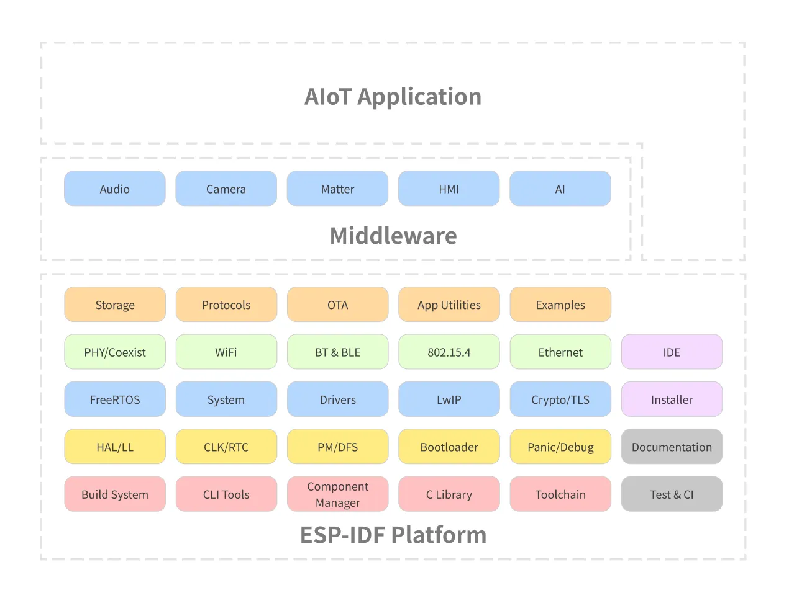
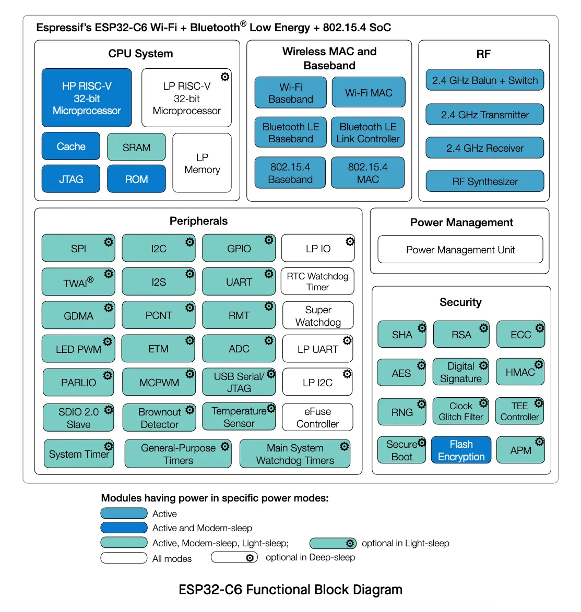
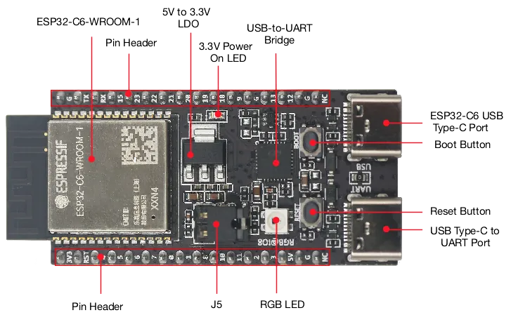
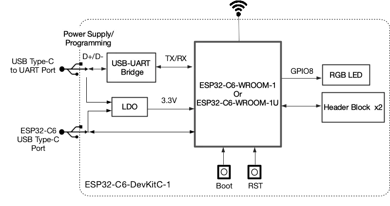
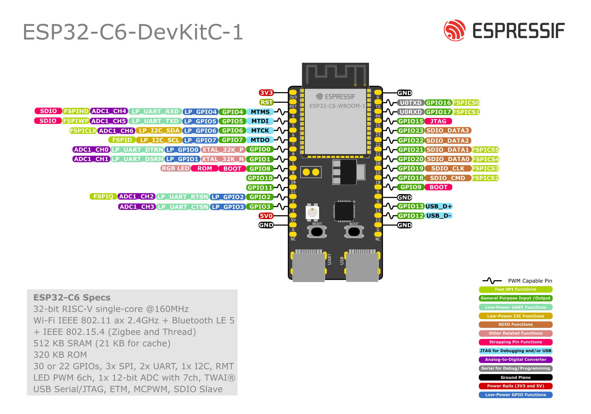

## Přednáška: Úvod do ESP-IDF

**ESP-IDF** (Espressif IoT Development Framework) je oficiální vývojový framework pro čipy řady ESP32 od firmy Espressif Systems. Poskytuje kompletní prostředí pro tvorbu IoT aplikací se spolehlivou podporou sítí, zabezpečení a dalších funkcí.

ESP-IDF v sobě obsahuje FreeRTOS, který vývojářům umožňuje tvořit *real-time* aplikace s podporou multitaskingu. Díky široké paletě knihoven, komponent, protokolů, nástrojů a podrobné dokumentaci ESP-IDF usnadňuje vývoj a umožňuje jednoduché propojení s hardwarem a periferiemi, jako jsou Wi-Fi, Bluetooth, Thread, ZigBee a cloudové služby.

ESP-IDF obsahuje téměř 400 příkladových projektů, které pokrývají širokou škálu případů použití a pomáhají vývojářům rychle začít pracovat na svých projektech.

### Architektura

Architektura platformy ESP-IDF je rozdělená do 3 vrstev:

- **ESP-IDF platforma**
  - Obsahuje samotné jádro a celý operační systém: FreeRTOS, ovladače, build system, protokoly atd.
- **Middleware**
  - Přidává další funkcionalitu do ESP-IDF, například audio framework nebo HMI.
- **AIoT aplikace**
  - Váš projekt.

Všechny bloky potřebné pro stavbu vaší aplikace jsou součástí platformy ESP-IDF.

### Frameworky

Na ESP-IDF je založeno i několik dalších frameworků:

- **Arduino for ESP32**
- **ESP-ADF** (Audio Development Framework): Připravený pro audio aplikace.
- **ESP-WHO** (AI Development Framework): Zaměřený na rozpoznávání a detekci obličeje.
- **ESP-RainMaker**: Díky cloudovým službám zjednodušuje připojení a ovládání zařízení.
- **ESP-Matter SDK**: Oficiální vývojový framework pro Matter na čipech rodiny ESP32.

Pokud se chcete podívat na všechny podporované frameworky, navštivte naši
[stránku na GitHubu](https://github.com/espressif).

### Aktuálně podporované verze

Aktuální seznam podporovaných verzí a dobu jejich údržby najdete na GitHubu projektu ESP-IDF.

[espressif/esp-idf na GitHubu](https://github.com/espressif/esp-idf)

## Představení ESP32-C6

ESP32-C6 je *ultra-low-power* čip s architekturou RISC-V. Obsahuje jedno "plnohodnotné" a jedno ULP (*ultra-low-power*) jádro a podporuje všechny běžné bezdrátové technologie:  2.4 GHz Wi-Fi 6 (802.11ax), Bluetooth® 5 (LE), Zigbee a Thread (802.15.4). K dispozici je volitelná 4MB flash paměť přímo v pouzdře čipu, 22 nebo 30 GPIO pinů a bohatá nabídka periferií:

- 30 (QFN40) nebo 22 (QFN32) pinů
- 5 strapping piny
- 6 GPIO pinů je potřebných pro in-package flash
- **Analogová rozhraní:**
  - 12-bit SAR ADC, až 7 kanálů
  - Senzor teploty
- **Digitální rozhraní:**
  - 2x UARTs
  - Low-power (LP) UART
  - 2x SPI pro komunikaci s flash pamětí
  - SPI pro obecné použití
  - I2C
  - Low-power (LP) I2C
  - I2S
  - Pulse count kontroler
  - USB Serial/JTAG kontroler
  - 2x TWAI® kontrolery, kompatibilní s ISO 11898-1 (CAN Specification 2.0)
  - SDIO 2.0 slave kontroler
  - LED PWM controller, až 6 kanálů
  - Motor Control PWM (MCPWM)
  - Remote control periferie (TX/RX)
  - Paralelní IO rozhraní (PARLIO)
  - Obecný DMA kontroler se 3 transmit 3 receive kanály
  - Event task matrix (ETM)
- **Timery:**
  - 52-bit systémový timer
  - 2x 54-bit timer pro obecné použití
  - 3x digitální watchdog
  - Analogový watchdog

Pro více detailů se podívejte na
[datasheet ESP32-C6](https://www.espressif.com/sites/default/files/documentation/esp32-c6_datasheet_en.pdf).

### Wi-Fi 6 (IEEE 802.11ax)

Wi-Fi 6, známé také jako IEEE 802.11ax, je nejnovější generace technologie Wi-Fi, navržená tak, aby
zlepšila efektivitu, kapacitu a výkon v nejrůznějších prostředích. Mezi hlavní vlastnosti Wi-Fi 6
u zařízení, jako je ESP32-C6, patří:

- **Režim Non-AP pouze s 20 MHz**: Tento režim funguje v roli klienta (ne přístupového bodu) a využívá
  kanál o šířce 20 MHz.
- **MCS0 ~ MCS9**: Podpora modulačních a kódovacích schémat od MCS0 do MCS9, která určují
  přenosové rychlosti a odolnost signálu.
- **Uplink a Downlink OFDMA**: Ortogonální vícenásobný přístup s frekvenčním dělením umožňuje efektivní
  souběžné připojení více zařízení, což je výhodné zejména v prostředích s vysokou hustotou zařízení.
- **Downlink MU-MIMO**: Technologie s více uživateli a více anténami zvyšuje kapacitu sítě tím, že
  umožňuje vysílat data více zařízením současně.
- **Beamforming**: Zlepšuje kvalitu signálu tím, že Wi-Fi signál soustředí směrem k přijímacímu
  zařízení.
- **Channel Quality Indication (CQI)**: Poskytuje zpětnou vazbu o stavu kanálu v reálném čase,
  což pomáhá s dynamickým přizpůsobením pro optimální výkon.
- **DCM (Dual Carrier Modulation)**: Zvyšuje odolnost spoje použitím dvou nosných.
- **Spatial Reuse**: Maximalizuje paralelní přenosy tím, že umožňuje více zařízením komunikovat
  současně na stejné frekvenci bez významného rušení.
- **Target Wake Time (TWT)**: Optimalizuje úsporu energie plánováním konkrétních časů, kdy se zařízení
  probudí a komunikuje, což prodlužuje výdrž baterie.

**Podpora 802.11ax ve Wi-Fi MAC vrstvě:**

- Target wake time (TWT) requester
- Více BSSID
- Triggered response scheduling
- Uplink power headroom
- Operating mode
- Buffer status report
- Rámce Multi-user Request-to-Send (MU-RTS), Multi-user Block ACK Request (MU-BAR) a Multi-STA
  Block ACK (M-BA)
- Intra-PPDU power saving mechanism
- Dva network allocation vectory (NAV)
- BSS coloring
- Spatial reuse
- TXOP duration RTS threshold
- UL-OFDMA random access (UORA)

### Zdroje

- [ESP32-C6 Datasheet](https://www.espressif.com/sites/default/files/documentation/esp32-c6_datasheet_en.pdf)
- [ESP32-C6 Documentation](https://docs.espressif.com/projects/esp-idf/en/release-v5.5/esp32c6/index.html)
- [ESP32-C6-DevKit-C Documentation](https://docs.espressif.com/projects/espressif-esp-dev-kits/en/latest/esp32c6/esp32-c6-devkitc-1/user_guide.html)

## Představení kitu ESP32-C6-DevKit-C

ESP32-C6-DevKitC-1 je vývojová deska určená (nejen) začátečníkům, v jejímž srdci je modul
ESP32-C6-WROOM-1(U) s 8 MB SPI flash paměti. Deska nabízí kompletní podporu Wi-Fi, Bluetooth LE,
Zigbee a Thread.

Většina I/O pinů je přístupná z pinových vývodů po obou stranách desky. Periferie lze připojit
pomocí propojovacích vodičů, případně lze desku zacvaknout do nepájivého pole.

### Vlastnosti

Níže jsou uvedené základní vlastnosti vývojového kitu:

- ESP32-C6-WROOM-1 modul
- Pinové vývody po stranách
- 5 V to 3.3 V LDO regulátor
- 3.3 V Power On LED
- USB-to-UART Bridge
- ESP32-C6 USB Type-C port pro flashování a debug
- Boot Button
- Reset Button
- USB Type-C to UART port
- RGB LED připojená na pin GPIO8
- J5 jumper pro měření proudu.

#### Popis desky

#### Pinout desky

#### J1 pinové pole

| No. | Name | Type | Function |
|---|---|---|---|
| 1 | 3V3 | P | 3.3 V power supply |
| 2 | RST | I | High: enables the chip; Low: disables the chip. |
| 3 | 4 | I/O/T | MTMS (strapping pin), GPIO4, **LP_GPIO4**, **LP_UART_RXD**, ADC1_CH4, FSPIHD |
| 4 | 5 | I/O/T | MTDI (strapping pin), GPIO5, **LP_GPIO5**, **LP_UART_TXD**, ADC1_CH5, FSPIWP |
| 5 | 6 | I/O/T | MTCK, GPIO6, **LP_GPIO6**, **LP_I2C_SDA**, ADC1_CH6, FSPICLK |
| 6 | 7 | I/O/T | MTDO, GPIO7, **LP_GPIO7**, **LP_I2C_SCL**, FSPID |
| 7 | 0 | I/O/T | GPIO0, XTAL_32K_P, **LP_GPIO0**, **LP_UART_DTRN**, ADC1_CH0 |
| 8 | 1 | I/O/T | GPIO1, XTAL_32K_N, **LP_GPIO1**, **LP_UART_DSRN**, ADC1_CH1 |
| 9 | 8 | I/O/T | GPIO8 (strapping pin, drives the RGB LED) |
| 10 | 10 | I/O/T | GPIO10 |
| 11 | 11 | I/O/T | GPIO11 |
| 12 | 2 | I/O/T | GPIO2, **LP_GPIO2**, **LP_UART_RTSN**, ADC1_CH2, FSPIQ |
| 13 | 3 | I/O/T | GPIO3, **LP_GPIO3**, **LP_UART_CTSN**, ADC1_CH3 |
| 14 | 5V | P | 5 V power supply |
| 15 | G | G | Ground |
| 16 | NC | – | No connection |

#### J3 pinové pole

| No. | Name | Type | Function |
|---|---|---|---|
| 1 | G | G | Ground |
| 2 | TX | I/O/T | U0TXD, GPIO16, FSPICS0 |
| 3 | RX | I/O/T | U0RXD, GPIO17, FSPICS1 |
| 4 | 15 | I/O/T | GPIO15 (strapping pin) |
| 5 | 23 | I/O/T | GPIO23, SDIO_DATA3 |
| 6 | 22 | I/O/T | GPIO22, SDIO_DATA2 |
| 7 | 21 | I/O/T | GPIO21, SDIO_DATA1, FSPICS5 |
| 8 | 20 | I/O/T | GPIO20, SDIO_DATA0, FSPICS4 |
| 9 | 19 | I/O/T | GPIO19, SDIO_CLK, FSPICS3 |
| 10 | 18 | I/O/T | GPIO18, SDIO_CMD, FSPICS2 |
| 11 | 9 | I/O/T | GPIO9 (strapping pin) |
| 12 | G | G | Ground |
| 13 | 13 | I/O/T | GPIO13, USB_D+ |
| 14 | 12 | I/O/T | GPIO12, USB_D- |
| 15 | G | G | Ground |
| 16 | NC | – | No connection |

## Další krok

Po teoretickém úvodu nastal čas pustit se do práce. Nejprve si ale musíme nainstalovat vývojové prostředí.

[Úkol 1: Instalace ESP-IDF](../assignment-1/)
